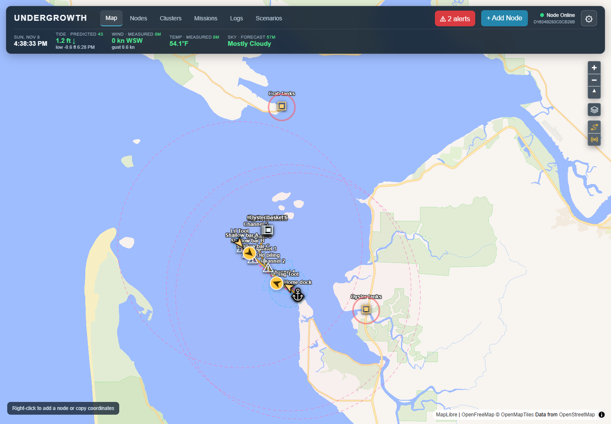
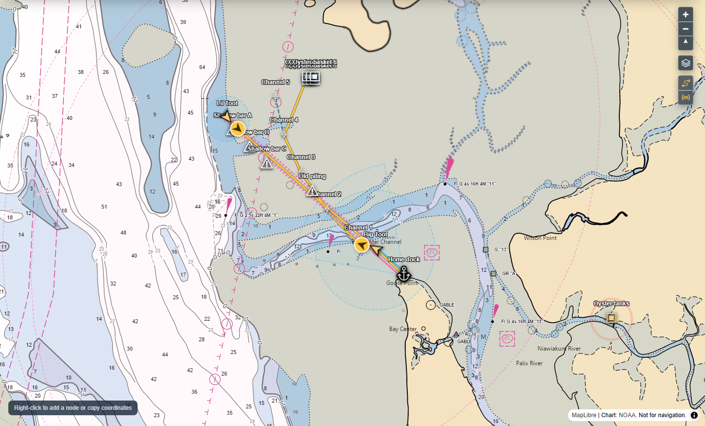
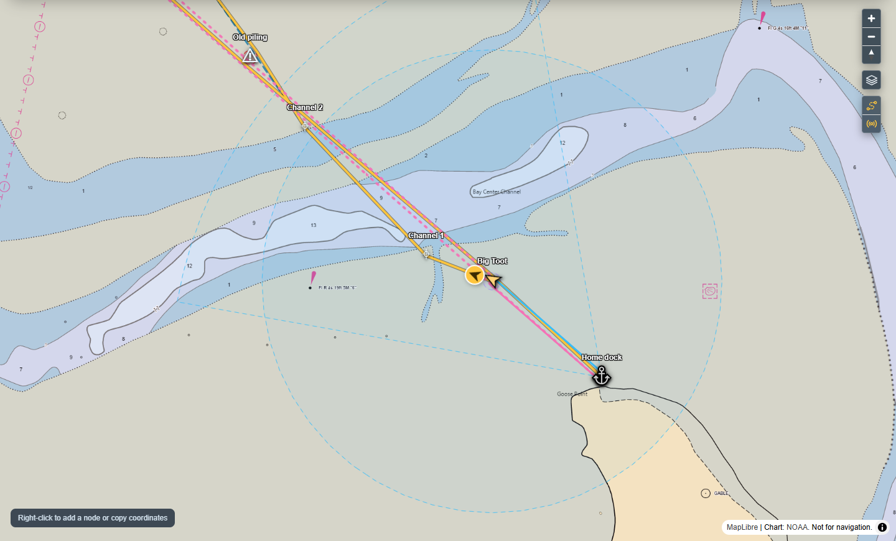

# Undergrowth guide

Undergrowth watches and runs the things in a project, whatever the project
is: a greenhouse, a workshop, a pool, a home, a lab, or a fleet of boats. It
reads sensors, switches equipment, raises an alarm when something goes wrong,
and writes down every reading, command and decision, with when and why. It
runs on computers you may already own, like an old phone or a laptop, with no
central server.

These pages show what it does today. It is a prototype, and the pictures come
from its built-in [scenarios](scenarios.md), not real records. Most are from
*The whole farm*, an oyster farm with boats, baskets and holding tanks, because
that is where Undergrowth was first tried. The Data and Reports pages show the
computer and bench board they were taken on.

## A few kinds of project

The same pieces fit very different jobs:

- **A greenhouse:** a thermometer in each grow room, lights and fans on relays,
  and a tablet as the screen people look at. See
  [Setting up a greenhouse](setup-greenhouse.md).
- **A pool or a holding tank:** a floating thermometer, and a heater on a plug
  that Undergrowth switches when the water gets cold.
- **A home or a workshop:** a heater kept to a temperature, a light on a
  schedule, and an alert when a sensor goes quiet.
- **A fleet of boats:** a GPS and a tilt sensor on each boat, a map that
  advises the way around hazards, and an alarm if one tips over.

None of it needs a map. Things with a place show on one, and everything else
works from the lists of [nodes](nodes.md) and [clusters](clusters.md).

## How it fits together

New to all this? **[Three ideas](three-ideas.md)** shows nodes, clusters and
missions in pictures, with everyday examples.

- A **[node](nodes.md)** is one thing: a thermometer, a heater plug, a grow
  light, a GPS. Everything starts as a node.
- A **[cluster](clusters.md)** is a group. A grow room is its thermometer,
  lights and fan; a tank is a thermometer and a heater plug, and a tank house
  is a cluster of tanks; a boat is a cluster of its parts.
- A **[mission](missions.md)** is a goal, such as "lights on from 6:00 to
  18:00", "keep the crab tanks between 42 and 60 °F" or "take Big Toot to
  basket 4". Undergrowth keeps checking it against what is happening now.
- **[Graphs](graphs.md)** draw readings as dots, with alerts and commands
  laid over them, so you can see what happened when.
- **[Logs](logs.md)** write down every reading, command and decision, with when
  and why.
- **[Data](data.md)** shows how much room all of that takes, what is kept,
  and the archives old data has been zipped into.
- **[Reports](reports.md)** are Letter pages that fill themselves in from the
  readings, to print or save as a PDF.

## On the water: the nautical chart

For a project on the water, the map can also be NOAA's nautical chart, with
depth soundings, channels, buoys and lights. Boats, routes, keep-outs and
mission paths sit on top of it. Here, in *The whole farm*, the boats are
working the channel out from the home dock:

Closer in, Big Toot's planned path (gold) follows the channel waypoints past
the old piling, and the dock's Wi-Fi beam and LoRa link reach out to it:

Charts are shown for reference only, not for navigation. See
[map styles](map.md#map-styles) for the satellite and topographic maps too.

## The guide

Start with **[Getting started](getting-started.md)**: setting it up and a first
look around. On a Linux computer, **[Installing on Linux](install-on-linux.md)**
goes through it one step at a time, and on an Android phone or tablet,
**[Installing on Android](install-on-android.md)**.

Then one page for each section in the top bar, in the same order:

| Section | What it covers |
|---|---|
| [Map](map.md) | The map and its symbols, live weather, wind and tide, map styles and the nautical chart |
| [Nodes](nodes.md) | What a node is and why everything starts as one; positions, values, displays, keep-outs and the editor |
| [Clusters](clusters.md) | Groups of things: rooms, tank houses, boats and routes; displays that open inside each other; taking a boat in tow |
| [Missions](missions.md) | One kind of mission (when, do, priority): setting controls, alerts, and advising a boat the way along routes and around keep-outs |
| [Scenarios](scenarios.md) | Small ready-made examples to try, apart from your real records |
| [Graphs](graphs.md) | Readings as dots over time or against each other, in bands of colour, with alerts and commands laid over them |
| [Logs](logs.md) | The record of everything that happened, and how to read it |
| [Data](data.md) | How much room Undergrowth takes, choosing what to store, and archiving old data into zips |
| [Reports](reports.md) | Live Letter pages built from tiles (figures, graphs, tables, logs, outages, sudden changes), printed in colour or black and white |

Also:

| Page | What it covers |
|---|---|
| [Three ideas](three-ideas.md) | Nodes, clusters and missions in pictures, with everyday examples, for anyone new to Undergrowth |
| [Fundamental logic](fundamental-logic.md) | The rules every feature has to fit: nodes, clusters, missions with priorities, commands, displays |
| [Walkthroughs](walkthroughs.md) | Building a boat and a crab tank from scratch, step by step |
| [Manual override](manual-override.md) | Setting a position or reading by hand to test things |
| [Radios and connections](radios-and-connections.md) | Which radios can reach each other, and which are connected |
| [Installing on Linux](install-on-linux.md) | Putting Undergrowth on a Linux computer step by step, updating it, and fixing common problems |
| [Installing on Android](install-on-android.md) | Putting the Undergrowth app on an Android phone or tablet, updating it, and fixing common problems |
| [Setting up a greenhouse](setup-greenhouse.md) | For installers: a Linux computer, two Bluetooth thermometers in two grow rooms, alerts, and an Android tablet as the screen |
| [Hardware compatibility](hardware-compatibility.md) | Which computers, phones, boards and sensors Undergrowth runs on or reads from, and how far each has been tried |
| [Sharing between computers](sharing.md) | Each computer's own records, read-only copies, letting a phone's browser in as a screen, and a Pi with its phone and ESP32 boards |
| [Undergrowth versions](undergrowth-versions.md) | Undergrowth, Undergrowth Lite and Undergrowth Micro; the current version and earlier ones |

## Not built yet

- Boats steering themselves. Missions give advice and a person still drives.
- A single button for taking a boat in tow. Today it takes
  [two edits](clusters.md#taking-a-boat-in-tow).
- Sharing missions between computers. Records, readings and logs are already
  shared; [Sharing between computers](sharing.md) lists what else is missing.

---

*Undergrowth's code is not public. Pictures show a built-in scenario, not live
data.*
