# Undergrowth guide

Undergrowth keeps track of an oyster farm's boats, baskets, tanks and sensors
on one map. It works out where boats should go, switches equipment, and raises
an alarm when something goes wrong. These pages show what it does today. It is
a prototype, and every picture comes from *The whole farm*, one of its built-in
scenarios, not a real farm.

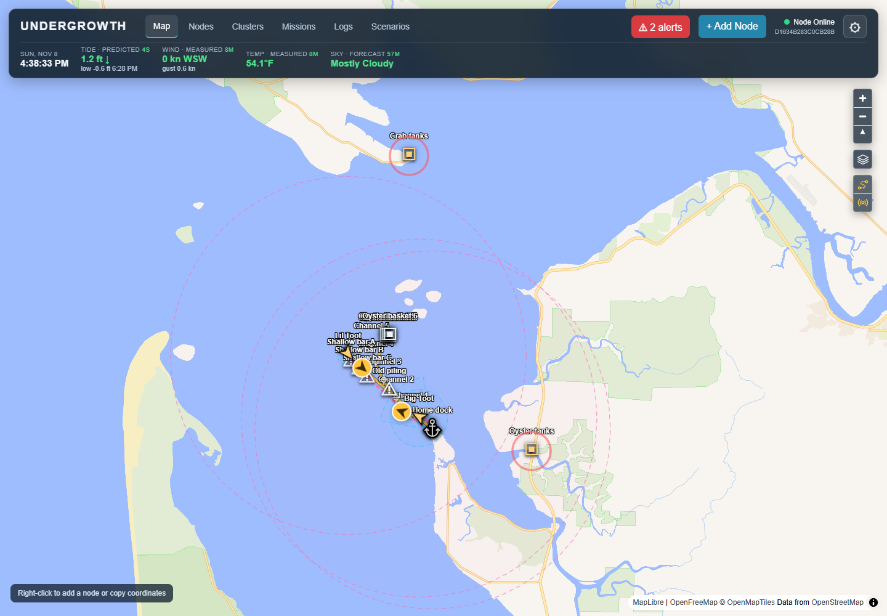

## On the nautical chart

The map can also be NOAA's nautical chart, with depth soundings, channels,
buoys and lights. Boats, routes, keep-outs and mission paths sit on top of it.
Here the boats are working the channel out from the home dock:

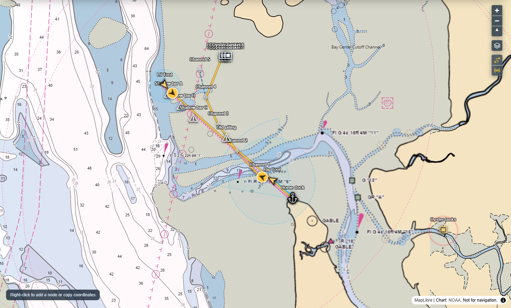

Closer in, Big Toot's planned path (gold) follows the channel waypoints past
the old piling, and the dock's Wi-Fi beam and LoRa link reach out to it:

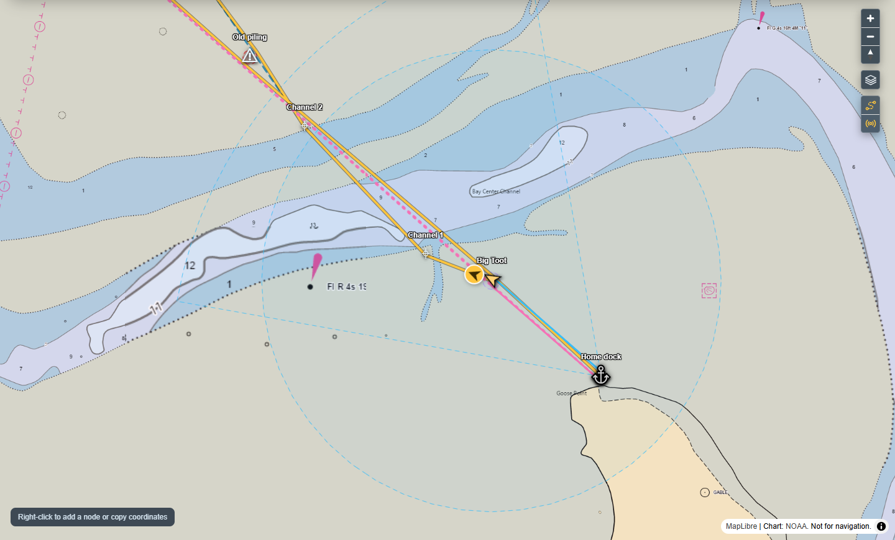

Charts are shown for reference only, not for navigation. See
[map styles](map-and-conditions.md#map-styles) for the satellite and
topographic maps too.

## Nodes, clusters and missions

Everything is a **node**: a GPS, a heater plug, an oyster basket, a dock.
Nodes are grouped into **clusters**, which can hold other clusters too. A
vessel is a cluster of its parts, a tank is a thermometer and a heater plug,
and a tank house is a cluster of tanks. A **mission** is a goal, such as
"take Big Toot to basket 4" or "keep the crab tanks between 42 and 60 °F".
Undergrowth keeps checking it against what is happening now, and writes down
each decision and why it was made.

You don't have to describe everything up front. A dock can start as one node.
When you add its Wi-Fi and cameras later, **Make it a cluster** in its editor
turns it into a cluster that holds them. It keeps its ID, readings, missions
and history, and anything already mounted on it becomes its first parts.

## Pages

| Page | What it covers |
|---|---|
| [Getting started](getting-started.md) | Setting it up and a first look around |
| [Built-in scenarios](built-in-scenarios.md) | Small ready-made examples to try, apart from your real records |
| [Walkthroughs](scenarios.md) | Building a boat and a crab tank from scratch, step by step |
| [The map and conditions](map-and-conditions.md) | The map, map styles, and live tide, wind and weather |
| [Vessels and missions](vessels-and-missions.md) | Vessels and their parts, routes, keep-outs, navigate missions, and taking a boat in tow |
| [Radios and connections](radios-and-connections.md) | Which radios can reach each other, and which are connected |
| [Manual override](manual-override.md) | Setting a position or reading by hand to test things |
| [Tanks and controls](tanks-and-controls.md) | Sensor readings, readings typed in by hand, switches and buttons |
| [Safety watches](safety-watches.md) | Alerts for tipping, getting too close, tank temperature and quiet sensors |
| [Logs and history](logs-and-history.md) | The record of everything that happened, and how to read it |
| [Sharing between computers](sharing.md) | Each boat's own computer, read-only copies, and the ESP32 boards |

## Map symbols

| Symbol | Meaning |
|---|---|
| 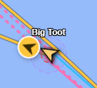 | A vessel. The arrow points the way it is heading. The small dashed circle is how far other vessels keep away. |
| 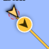 | Mission advice. The gold circle shows which way the mission says to go, and the gold line is the planned path. |
| 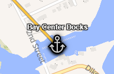 | A port or dock. |
| 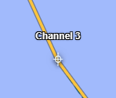 | A route waypoint. Routes are dashed blue lines between their waypoints. |
| 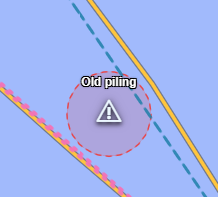 | A keep-out, such as an old piling or a sandbar. Vessels steer around the red circle. |
| 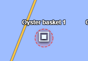 | An oyster basket. Vessels that aren't collecting it keep a small distance. |
| 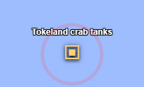 | A tank house, holding a group of tanks. A pulsing ring means one of its tanks has an alert. |
| 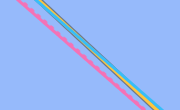 | Radio connections. Solid is connected, dotted is in range but not connected, and the colour is the kind of radio. See [Radios and connections](radios-and-connections.md). |
| 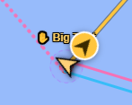 | ✋ Set by hand. An orange name with a hand means part of it is under [manual override](manual-override.md). |

## Not built yet

- Boats steering themselves. Missions give advice and a person still drives.
- A single button for taking a boat in tow. Today it takes
  [two edits](vessels-and-missions.md#taking-a-boat-in-tow).
- Sharing missions between computers. Records, readings and logs are already
  shared; [Sharing between computers](sharing.md) lists what else is missing.

---

*Undergrowth's code is not public. Pictures show a built-in scenario, not live
data.*
