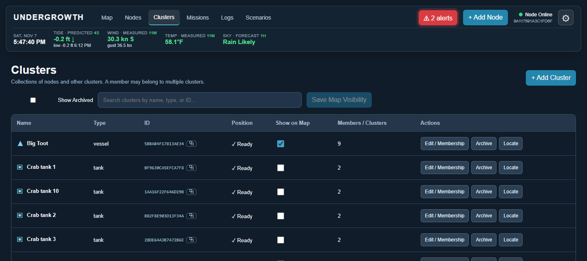

# Clusters

[← Guide](README.md) · [Map](map.md) · [Nodes](nodes.md) · **Clusters** · [Missions](missions.md) · [Logs](logs.md) · [Scenarios](scenarios.md)

## What a cluster is

A cluster is **a group**: of [nodes](nodes.md), of other clusters, or both.

- A **vessel** is a cluster of its parts: GPS, motor controller, radios, tilt
  sensor.
- A **tank** is a cluster of a thermometer and a heater plug, and a **tank
  house** is a cluster of tanks.
- A **route** is a cluster of waypoints, and a **bed** is a cluster of
  baskets.

Clusters can hold clusters as deep as you like, and one thing can belong to
more than one cluster. A cluster can have values of its own too: a tank has
salinity and pH, which belong to the tank rather than to any one part.

Treating a group as one thing is what lets Undergrowth say "Big Toot is here,
heading 300°" instead of listing eight parts, and lets one safety watch cover
every tank in a house.

## The Clusters page

**Clusters** in the top bar lists every cluster. It works like the
[Nodes page](nodes.md#the-nodes-page): search, show on map, edit, archive,
locate and restore. **Members / Clusters** is how many members each one has.

In a cluster's editor, **Cluster Members** has a tick box for every node and
every other cluster.

## Where a cluster is

A cluster takes its place from some of its members, chosen with **＋** next to
**Position** in its editor, or has coordinates of its own:

- a **vessel** is wherever its GPS is, and its other parts follow;
- a **bed** is the centre of its baskets;
- a **tank house** has the coordinates of the building.

## Vessels

Click a vessel and its panel lists what it is made of. In *The whole farm*
scenario, *Big Toot* has a GPS, a motor controller, a latch, a solar panel, a
tilt sensor, a computer and radios.

 

The panel shows:

- **Mission advice** in the gold box: which way to head, how far to go, and why
  ("Head 291° toward Oyster basket 4 via route, next Channel 1, steering around
  Old piling"). See [Missions](missions.md).
- **Controls**: one row per value from any of its parts, described under
  [Nodes](nodes.md#values).

## Tank houses

*The whole farm* scenario has two tank houses: **Crab tanks** (10 tanks) and
**Oyster tanks** (8 tanks). Each tank has:

- a **floating thermometer** (Bluetooth/Zigbee pool thermometer): water
  temperature and battery;
- a **heater plug**: a remote plug relay Undergrowth can switch, plus how much
  power the heater is drawing (this shows whether a self-regulating heater is
  actually heating);
- readings **typed in by hand**: salinity, pH, and whether bay water is flowing.

Click a tank house to see all its tanks in one list. A tank with an alert is
flagged in red, and **Open** goes to that tank's own panel.

 

The *Crab tank goes cold* [scenario](scenarios.md) switches a heater off and
lets a tank go cold, to see what happens on a winter night.

## Changing what a panel shows

A motor controller, a vessel and a tank house each need different things on
screen. Press **Customize** in any panel to:

- move rows up and down (↑ ↓) or remove them (✕);
- add a row for any value of anything inside it;
- add a **new value**: give it a name, say whether people type it in, a sensor
  reports it, or Undergrowth controls it, and give a unit and range.

Changes save immediately. **Back to automatic column** undoes them.

## Making a node a cluster

Anything can start as a single node and become a cluster later, when it gets
parts. **Make it a cluster** in the node's editor does it. It keeps its ID,
readings, missions and history. See [why everything starts as a
node](nodes.md#why-everything-starts-as-a-node).

## Taking a boat in tow

Sometimes two boats become one: a boat with a failed engine is towed home, or
a barge is pushed along by a skiff. Undergrowth does this with two edits:

1. **Make the towed boat part of the other.** Open the boat doing the towing,
   press **Edit**, and tick the towed boat under **Cluster Members**.
2. **Give the towed boat the other's position.** Open the towed boat, press
   **Edit**, press **＋** next to **Position**, tick the boat doing the towing,
   untick the towed boat's own GPS, and save.

Now the towed boat goes wherever the other goes. Safety watches treat it as a
part of the boat doing the towing, so being alongside doesn't set off a
too-close alarm. To cast off, undo both edits.

A boat sent on a mission to another boat is never warned about getting close
to it, so a rescue boat can come alongside without an alarm. Once the mission
is marked complete, the two are just boats again until they are joined. The
*Rescue* [scenario](scenarios.md) walks through all of this.
