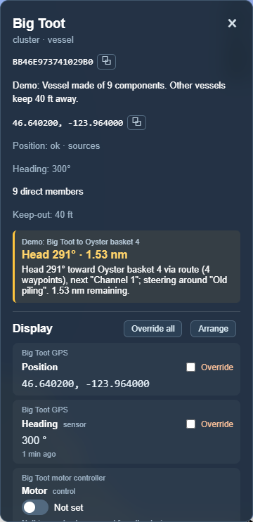
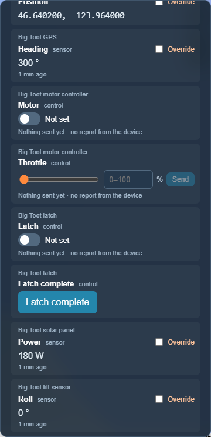
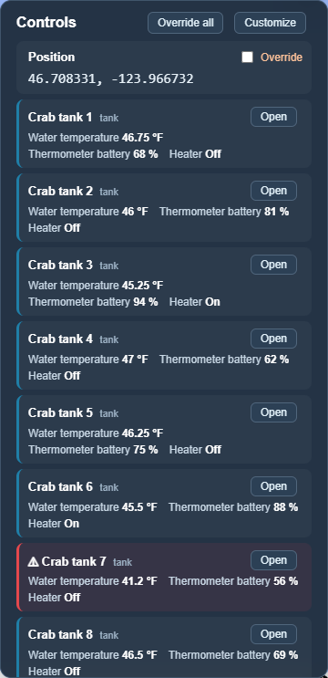
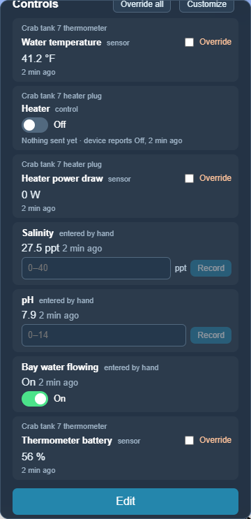
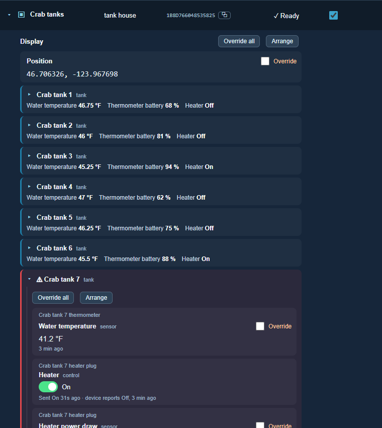

# Clusters

[← Guide](README.md) · [Map](map.md) · [Nodes](nodes.md) · **Clusters** · [Missions](missions.md) · [Scenarios](scenarios.md) · [Graphs](graphs.md) · [Logs](logs.md) · [Data](data.md) · [Reports](reports.md)

## What a cluster is

A cluster is **a group**: of [nodes](nodes.md), of other clusters, or both.

- A **vessel** is a cluster of its parts: GPS, motor controller, radios, tilt
  sensor.
- A **tank** is a cluster of a thermometer and a heater plug, and a **tank
  house** is a cluster of tanks.
- A **route** is a cluster of waypoints, and a **bed** is a cluster of
  baskets.

Clusters can hold clusters as deep as you like, and one thing can belong to
more than one cluster. A cluster can have values of its own too: a tank has
salinity and pH, which belong to the tank rather than to any one part.

Treating a group as one thing is what lets Undergrowth say "Big Toot is here,
heading 300°" instead of listing eight parts, and lets one mission cover
every tank in a house.

## The Clusters page

**Clusters** in the top bar lists every cluster. It works like the
[Nodes page](nodes.md#the-nodes-page): search, show on map, edit, archive,
locate and restore. **Members / Clusters** is how many members each one has.

In a cluster's editor, **Cluster Members** has a tick box for every node and
every other cluster.

## Where a cluster is

A cluster takes its place from some of its members, chosen with **＋** next to
**Position** in its editor, or has coordinates of its own:

- a **vessel** is wherever its GPS is, and its other parts follow;
- a **bed** is the centre of its baskets;
- a **tank house** has the coordinates of the building.

## Vessels

Click a vessel and its panel lists what it is made of. In *The whole farm*
scenario, *Big Toot* has a GPS, a motor controller, a latch, a solar panel, a
tilt sensor, a computer and radios.

 

The panel shows:

- **Mission advice** in the gold box: which way to head, how far to go, and why
  ("Head 291° toward Oyster basket 4 via route, next Channel 1, steering around
  Old piling"). See [Missions](missions.md).
- **Display**: the rows chosen for it, here a row per value from its parts.
  See [Displays](nodes.md#displays) and [Values](nodes.md#values).

## Tank houses

*The whole farm* scenario has two tank houses: **Crab tanks** (10 tanks) and
**Oyster tanks** (8 tanks). Each tank has:

- a **floating thermometer** (Bluetooth/Zigbee pool thermometer): water
  temperature and battery;
- a **heater plug**: a remote plug relay Undergrowth can switch, plus how much
  power the heater is drawing (this shows whether a self-regulating heater is
  actually heating);
- readings **typed in by hand**: salinity, pH, and whether bay water is flowing.

Click a tank house to see all its tanks in one list. A tank with an alert is
flagged in red. **▸** opens a tank's display right there, and **Open** goes
to that tank's own panel.

 

The *Crab tank goes cold* [scenario](scenarios.md) switches a heater off and
lets a tank go cold, to see what happens on a winter night.

## A cluster's display

A cluster has a [display](nodes.md#displays) like any node, starting blank.
Besides readings and controls, it can hold the things inside it: each one
shows its name and a few readings, and **▸** opens its own display
underneath, nested inside. A tank house can list its tanks, each tank can open
to show its thermometer and heater, and none of it needs the map:

Adding something to a cluster doesn't change its display. The new tank is part
of the tank house straight away, and any mission looking at the tank house
covers it, but it only appears on the display when you add it with **＋**.

## Making a node a cluster

Anything can start as a single node and become a cluster later, when it gets
parts. **Make it a cluster** in the node's editor does it. It keeps its ID,
readings, missions and history. See [why everything starts as a
node](nodes.md#why-everything-starts-as-a-node).

## Taking a boat in tow

Sometimes two boats become one: a boat with a failed engine is towed home, or
a barge is pushed along by a skiff. Undergrowth does this with two edits:

1. **Make the towed boat part of the other.** Open the boat doing the towing,
   press **Edit**, and tick the towed boat under **Cluster Members**.
2. **Give the towed boat the other's position.** Open the towed boat, press
   **Edit**, press **＋** next to **Position**, tick the boat doing the towing,
   untick the towed boat's own GPS, and save.

Now the towed boat goes wherever the other goes. Alerting missions treat it as a
part of the boat doing the towing, so being alongside doesn't set off a
too-close alarm. To cast off, undo both edits.

A boat sent on a mission to another boat is never warned about getting close
to it, so a rescue boat can come alongside without an alarm. Once the mission
is marked complete, the two are just boats again until they are joined. The
*Rescue* [scenario](scenarios.md) walks through all of this.
