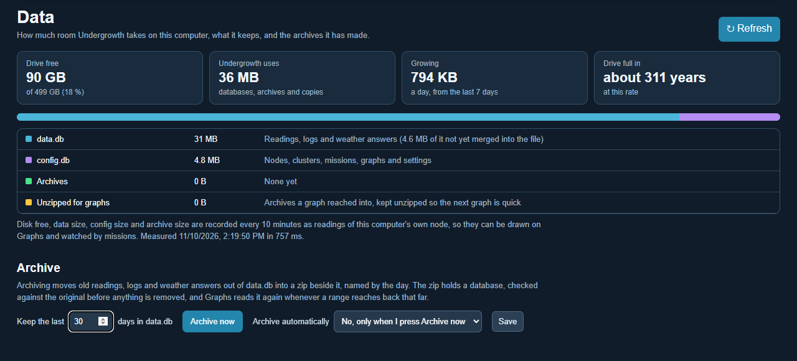

# Data

[← Guide](README.md) · [Map](map.md) · [Nodes](nodes.md) · [Clusters](clusters.md) · [Missions](missions.md) · [Scenarios](scenarios.md) · [Graphs](graphs.md) · [Logs](logs.md) · **Data**

The **Data** page shows how much room Undergrowth takes on this computer, what
it keeps, and the archives it has made.

## How much room

Along the top:

- **Drive free:** the free space on the drive the databases are on.
- **Undergrowth uses:** everything together.
- **Growing:** how much a day, worked out from what arrived over the last 7
  days (or since the last archive, if that was more recent).
- **Drive full in:** how long until the drive fills at that rate.

Below that, each part on its own:

| Part | What it holds |
|---|---|
| **data.db** | Readings, logs, and the weather and tide answers. Part of it may be waiting to be merged into the file; SQLite does that by itself. |
| **config.db** | Nodes, clusters, missions, graphs and settings. |
| **Archives** | The zips made by archiving, listed further down. |
| **Unzipped for graphs** | Archives a graph has reached into. They are kept unzipped so the next graph is quick, and **Clear** removes them; they are unzipped again when needed. |
| **Scenario copy** | The databases of the scenario on the [Scenarios](scenarios.md) page, if one is running. |

**Disk free**, **Data size**, **Config size** and **Archive size** are also
recorded every 10 minutes as readings of this computer's own node. Draw them
on [Graphs](graphs.md), or have a [mission](missions.md) raise an alert when
disk free drops below a number you choose.

## Archiving

Archiving moves old readings, logs and weather answers out of data.db into a
zip in the `archives` folder beside it, named by the day, such as
`data-2026-11-10.zip`.

1. Say how many days to keep in data.db. Everything older goes into the zip.
   0 archives everything.
2. Press **Archive now**, or choose to archive automatically every day, every
   Monday, or on the 1st of each month, at a time you pick, and press **Save**.

While it works, the page shows each step. In order:

1. Undergrowth takes a clean copy of data.db, which is safe while it is running.
2. It takes the last days you are keeping out of the copy, and zips what is left.
3. It reads the zip back and checks it matches the copy exactly.
4. Only then are those same rows removed from data.db, and the file is compacted.

So every reading and log entry is either in data.db or in one zip, never lost
in between. The newest reading of every value always stays in data.db, however
old it is, so the map and missions still have a current value.

The zip holds a database, `data.db`, with `about.json` saying which computer
made it, when, and what it covers. It opens in any SQLite tool, such as
DB Browser for SQLite. Each archive is listed with the dates it covers, how
many readings, log entries and weather answers it holds, and its size.
**Click the name to download it.**

When a graph's range reaches back into an archive, [Graphs](graphs.md) unzips
it once and reads it along with data.db. The graph says which archives it
used. The Logs page does not show archived entries yet.

## Choosing what to store

Every reading and every log category has a **Store** box, ticked to start
with.

- **Readings** are listed largest first, with how many there are, how many
  arrive a day, how much room they take, and the oldest and newest. Search to
  find one. Untick a reading to stop keeping its history: its newest reading
  is still kept, so the map and missions keep working, and what was already
  recorded stays until it is archived.
- **Logs** are listed by category. Untick one to stop writing its entries.
  Alerts still go out and missions still act; only the record of it is not
  kept. Safety and configuration ask first (⚠), because they are the record
  of what went wrong and who changed what, and Restore on the
  [Logs](logs.md) page relies on configuration entries.

Weather and tide answers are always kept until archived, because the
conditions bar falls back on them when the internet is out.
