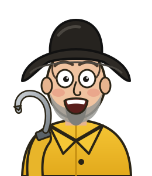

# Undergrowth: getting started



> *"Forty years on this bay, and the tide never once wrote down what it did.
> Undergrowth does."*
> — **Old Shucks**

**Undergrowth keeps track of everything on the farm (boats, baskets, tanks,
sensors) on one map, says where things should go, and raises the alarm when
something is wrong.** Every decision, command and reading is written down with
when and why.

## Three ideas

1. **Everything is a node.** A GPS, a heater plug, a basket, a dock.
2. **Clusters group nodes.** A boat is its parts. A tank house is its tanks.
3. **Missions are goals.** "Take Big Toot to basket 4." "Keep the crab tanks
   between 42 and 60 °F." Undergrowth keeps checking them against what is
   happening right now.

## Set it up (once)

You need **Node.js** (nodejs.org, the LTS version) and a copy of the Undergrowth
code. Then, in two separate terminal windows:

```bash
cd node-service
npm install
npm run dev
```

```bash
cd dashboard
npm install
npm run dev -- --port 3000
```

Open **http://localhost:3000**. Other computers on the same network can use
`http://<this computer's address>:3000`.

## Your first five minutes

| | Do this | You'll see |
|---|---|---|
| 1 | Press **⚙**, then **Add demo fleet**. | Two boats, a route, keep-outs, baskets, and 18 holding tanks. |
| 2 | Look at the bar along the top. | Live tide, wind, temperature and sky for the middle of the map, going green → brown as they age. |
| 3 | Click **Big Toot**. | Its parts, its mission advice ("Head 291°…") and its controls. |
| 4 | Tick **Override** next to its GPS position and drag the boat. | The plan follows wherever you put it. |
| 5 | Press the red **⚠ alerts** button. | A crab tank that has gone cold. **Show on map** takes you to it. |

> *"Drag that boat into the sandbar, lad. Go on. Undergrowth'll holler before
> the bar does."*

When you're done, **⚙ → Remove demo fleet** tidies it all away. Nothing is ever
truly deleted; it is all kept in **Logs**.

## Where next

- [The illustrated guide](README.md): every feature, with pictures.
- [Scenarios](scenarios.md): building a boat and a crab tank from scratch, step by step.
