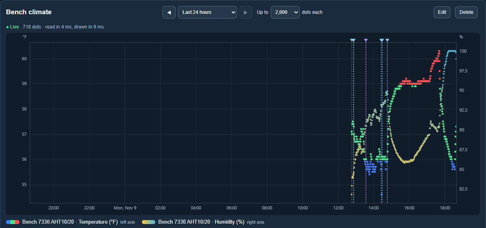
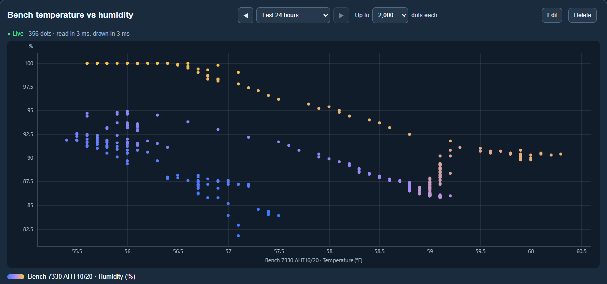
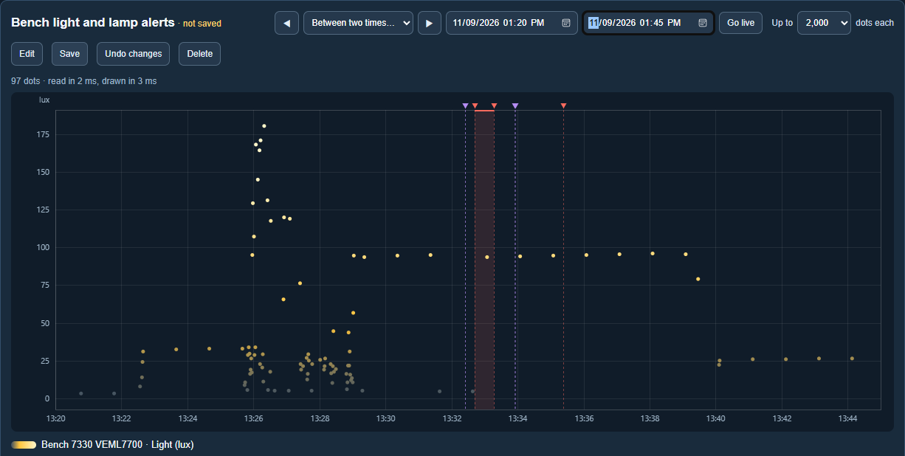

# Graphs

[← Guide](README.md) · [Map](map.md) · [Nodes](nodes.md) · [Clusters](clusters.md) · [Missions](missions.md) · [Scenarios](scenarios.md) · **Graphs** · [Logs](logs.md) · [Data](data.md) · [Reports](reports.md)

The **Graphs** page draws readings over time, or one reading against another,
with whatever happened at the time laid over them. Graphs are saved with a name
and listed along the top of the page.

## Dots, not lines

Every reading is a dot. Nothing joins them, so when a sensor stops reporting,
the graph shows a gap rather than a line drawn straight across it. Above, the
board only started reporting at about half past twelve, and the gaps in the
afternoon are times it was unplugged or restarted.

Hover a dot to see its reading, what it came from and exactly when.

## Stacking readings

A graph can stack up to eight readings. Each goes on the **left** or the
**right** axis, so temperature (°F) and humidity (%) can share a graph with
their own scales. Readings can come from any node on this computer, including
those [shared](sharing.md) from other computers.

## Colours

Each reading has its own colours, from one up to eight:

- **Bands.** Each colour runs from its number up to the next. With blue from
  54, green from 56 and red from 59, a steady green line means things are
  right, and a drop shows at once as a blue spike, a rise as a red one. It
  also tells swinging between too cold and too hot apart from swinging between
  hot and *too* hot. **Too low · right · too high** fills in three bands to
  start from; change the numbers to suit.
- **Blend.** Tick *Blend between colours* and each colour is exact at its
  number and mixed in between, such as yellow at 80 % humidity fading to blue
  at 100 %.
- **Colour by time.** The colours spread from the oldest dot to the newest, so
  you can see which way things drifted.

## One reading against another

Choose a reading for **Along the bottom** instead of Time, and each dot is one
moment: temperature along the bottom and humidity up the side, say. Readings are
rarely taken at exactly the same instant, so each one is paired with the other
reading as it stood then, if that was taken within the last 120 seconds (you
can change this).

## Laying things over a graph

Tick anything from [Logs](logs.md) to lay it over the graph, and untick it to
hide it again:

| Overlay | Shows as |
|---|---|
| Alerts, shaded from raised to cleared | A red shaded span |
| Alerts raised, acknowledged and cleared | A red mark |
| Commands sent and buttons pressed | A yellow mark |
| Mission decisions | A purple mark |
| Set by hand (overrides) | A pink mark |
| Sharing connected and lost | A light blue mark |
| Messages, service started, configuration and cluster changes | Their own marks |

Each mark is a dashed line with a flag at the top; hover it to read the log
entry. **About** chooses whether to show only things about what is on the graph
(the graphed nodes, the clusters they are in, the other things in those
clusters, and missions that mention any of them) or everything on this
computer. On a reading-against-reading graph, a dot taken while an alert was up
gets a red ring, and other marks sit on the dot nearest in time.

This is a desk lamp test of a [mission](missions.md) that alerts when the light
is below 50 lux: the lamp goes off at about 13:31 and light drops to about
5 lux, the alert is raised (the shaded span), and it clears once the lamp is
back on.

## How much to show

Choose the last hour, 6 hours, 24 hours, 3 days, 7 days, 30 days or a year,
or **Between two times**. **◀** and **▶** move back and forward by one range.
While showing the latest hours, the graph is **live** and redraws every 15
seconds; **Go live** returns to that.

**Up to … dots each** sets the most dots per reading (500 to 50,000). When a
range has more readings than that, it is cut into short stretches and the
highest and lowest reading of each stretch are drawn at their own times, so
spikes and gaps still show. The line above the graph always says how many dots
are drawn from how many readings, and how long reading the database and
drawing took. While it is still reading, it says so, with a running count of
seconds.

Changes to the range, dots and overlays show at once but are not kept until you
**Save**. **Undo changes** puts the graph back as saved.

## Where the readings come from

Graphs read this computer's own databases. Readings from other computers and
boards are already copied here by [sharing](sharing.md), so a graph of a
board's temperature is up to date as of its last share. Graphs are part of
Undergrowth only, not [Undergrowth Lite or Micro](undergrowth-versions.md).
