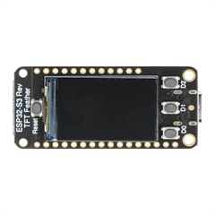
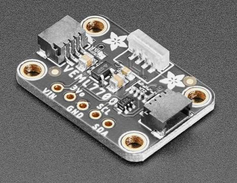
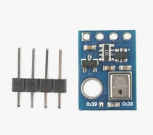
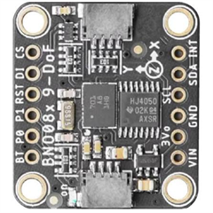
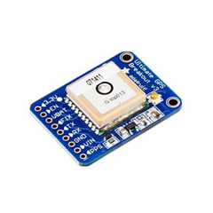
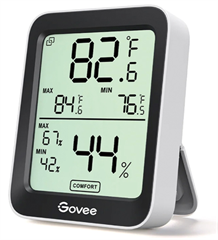
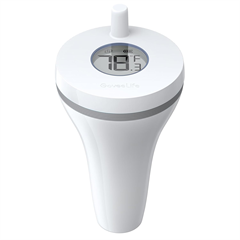
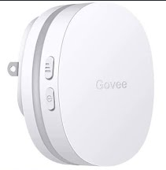

# Hardware compatibility

[← Guide](README.md)

What Undergrowth runs on, and what it can read from. Each row says how far it
has been tried:

- **Tested**: someone has run it and it worked.
- **Should work**: built for, and close to something tested, but not tried yet.
- **Planned**: not built yet.

If you try something new, say how it went, and this page gets a new row.

## Computers

A computer runs the full **Undergrowth**: the map, the history, missions and
reports. See [Undergrowth versions](undergrowth-versions.md) for the editions.

| Computer | Status | Notes |
|---|---|---|
| Windows 10 PC | Tested | Where Undergrowth is built. Hears Bluetooth sensors by itself. |
| Linux Mint | Tested | Installed by following [Installing on Linux](install-on-linux.md). |
| Ubuntu, and other Linux computers like it | Should work | The same steps as Linux Mint. |
| Windows 11 PC | Should work | |
| Raspberry Pi 4 | Planned | A computer of its own for a shed, a greenhouse or a boat, with its own records and radios. |
| Mac | Not tried | |

## Phones and tablets

A phone runs the full **Undergrowth** as an app, with its own GPS and compass.
Any phone or tablet can also be a screen for another Undergrowth computer, in
its web browser, once it is [let in](sharing.md#letting-a-screen-in).

| Phone or tablet | Status | Notes |
|---|---|---|
| Google Pixel 2 (Android 11) | Tested | The Undergrowth app, installed by following [Installing on Android](install-on-android.md). Its GPS places it on the map, and its compass points its arrow to true north. |
| Other Android phones and tablets, Android 8 or newer | Should work | The same app. |
| iPhone and iPad | Planned | Until then, they work as a screen for another Undergrowth computer, in Safari. |

## Boards

A board runs **Undergrowth Lite**: a small node with a plain status page, that
owns the sensors plugged into it and shares their readings over Wi-Fi. See
[Sharing between computers](sharing.md#a-pi-a-phone-and-a-board).

| | Board | Status | Notes |
|---|---|---|---|
|  | [Adafruit ESP32-S3 Reverse TFT Feather](https://learn.adafruit.com/esp32-s3-reverse-tft-feather/overview) | Tested | Wi-Fi, USB, its screen, buttons and light. Added from **+ Add Node** over USB. |
| | Other ESP32-S3 boards | Not tried | The firmware is built for the Reverse TFT Feather's screen and buttons. |

## Sensors on a board

Plugged into a board's I2C port (STEMMA QT). The board notices one within a few
seconds and it appears as a node of its own, already wired to the board.

| | Sensor | Reads | Status |
|---|---|---|---|
|  | VEML7700 | Light | Tested |
|  | AHT10 / AHT20 | Temperature and humidity | Tested |
|  | BNO08x | Heading, roll and pitch | Should work |
|  | GPS | Position, speed, course and time | Should work |

## Bluetooth sensors

These broadcast their readings to anything nearby every few seconds.
Undergrowth just listens: there is no pairing, no gateway, no app and no
account. A sensor in range shows up in
**+ Add Node** on the Nodes page, with its signal strength, and **Add** makes it a node:

```
Holding tank air ─Bluetooth→ This computer
```

Anyone nearby can read what these sensors broadcast, and someone could send
fake readings, so use them for watching, not for anything that must not be
wrong.

| | Sensor | Reads | Status |
|---|---|---|---|
|  | Govee H5075 thermometer | Temperature, humidity, battery | **Tested** on a Windows PC. **Should work** on Linux: built, not tried on a real sensor yet. **Planned** for Android phones and ESP32-S3 boards. |
| | Govee H5072 thermometer | Temperature, humidity, battery | **Should work** on a Windows PC or Linux: it broadcasts the same way as the H5075. |

A Windows PC listens with its own Bluetooth. The first time Undergrowth
starts, it builds a small listener with a tool that comes with Windows, so
there is nothing extra to install. If Bluetooth is turned off, **+ Add Node**
says so.

A Linux computer listens through BlueZ, Linux's own Bluetooth service, which
[Installing on Linux](install-on-linux.md) sets up. If **+ Add Node** says
something is wrong with Bluetooth, it also says what to type to fix it.

## Pool floats through their gateway

The GoveeLife Smart Thermometer P1 (Govee H5109) floating pool thermometers
only talk to their own Smart Gateway (H5042), over 433 MHz. They don't
broadcast over Bluetooth themselves.

The gateway passes their readings on over Bluetooth, but only while it has
**no Wi-Fi**. On Wi-Fi it keeps quiet unless Govee's app asks it to, through
Govee's online service. So:

1. Set up the gateway and pair the floats in Govee's app, once. On a phone
   without Google Play, the Govee Home app comes from
   [Govee's own download page](https://app-h5.govee.com/common/app-download).
2. Then take the gateway off Wi-Fi for good: change the Wi-Fi it joined, or
   turn that network off. Its light turns red. A few minutes later it starts
   broadcasting the floats' readings by itself, with no Wi-Fi, internet,
   account or app.

Each float then shows up in **+ Add Node** as **Pool float, slot 1**,
**slot 2** and so on, in the order they were paired with the gateway, with its
temperature now, so you can tell which is which. **Add** makes it a node, and
the first one also makes a node for the gateway:

```
Pool float 1 ─433 MHz→ Govee gateway 3F77 ─Bluetooth→ This computer
```

A float takes a reading every 10 minutes, and every few seconds while its
temperature is changing fast. Each one is recorded once, as of when the float
took it.

| | Sensor | Reads | Status |
|---|---|---|---|
| <br> | GoveeLife H5109 pool thermometer, through a Govee H5042 gateway kept off Wi-Fi | Water temperature, battery | **Tested** on a Windows PC with two floats. **Should work** on Linux: built, not tried yet. |

Tested overnight: with the gateway off Wi-Fi for 17 hours, two floats sent 84
readings each, one every 10 minutes, and none went missing. Each was heard
within seconds of the float taking it, and the gateway's clock stayed right.

The battery reading is the one byte that looks like battery: it reads 100 %
on new batteries, and hasn't been seen lower yet. Not tried yet: whether the
gateway goes back to broadcasting by itself after a power cut with no Wi-Fi.
