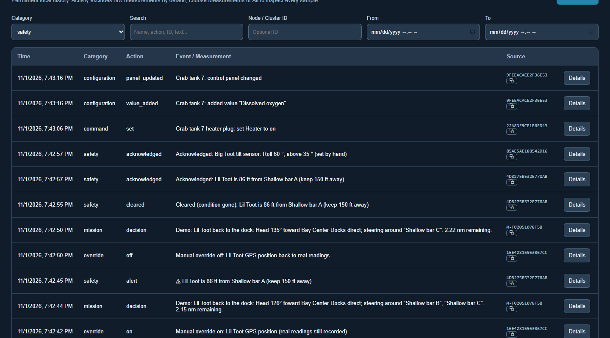
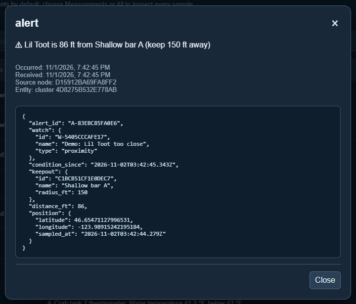

# Logs and history

[← Guide](README.md)

The **Logs** page is the permanent record. Nothing in it is edited or deleted.

## What gets recorded

| Category | Examples |
|---|---|
| **configuration** | A node or cluster created, changed, archived or restored; a value added; a panel customized. |
| **cluster** | Something added to or removed from a cluster. |
| **mission** | A mission created, finished or cancelled, and every time its decision changes, with the positions, route and keep-outs it was based on. |
| **override** | A reading taken over by hand, and given back. |
| **command** | A heater switched, a throttle set, a button pressed. |
| **safety** | An alert raised, cleared, or acknowledged. |
| **measurement** | Every raw reading: from sensors, typed in by hand, or set by hand during an override. (Hidden from *Activity* because there are so many; choose *measurement* or *All including measurements* to see them.) |

Filter by category, search for a name or ID, or limit to a date range.
**Details** shows exactly what was recorded. For an alert, that is the watch,
the reading or distance that set it off, and the position at the time:

## Where it is stored

Undergrowth keeps two databases on each computer:

- **config.db**: what *should* be (nodes, clusters, missions, watches, panels).
- **data.db**: what *happened* (logs and every reading).

Changes to configuration and their log entries are written together, so the
record cannot fall behind what was changed.
