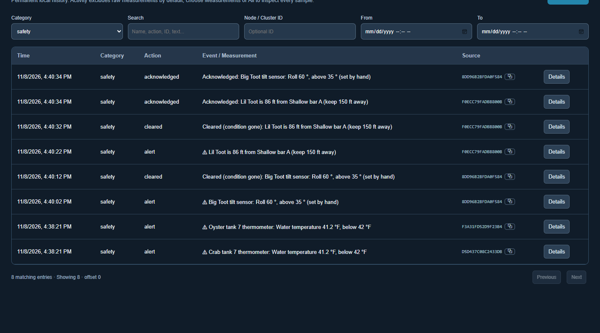
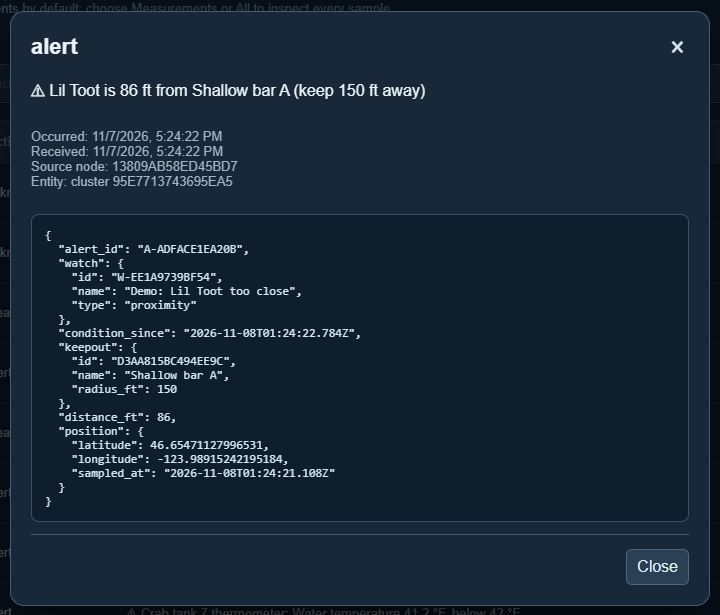

# Logs

[← Guide](README.md) · [Map](map.md) · [Nodes](nodes.md) · [Clusters](clusters.md) · [Missions](missions.md) · [Scenarios](scenarios.md) · [Graphs](graphs.md) · **Logs**

The **Logs** page is the permanent record. Nothing in it is edited or deleted.

## What gets recorded

| Category | Examples |
|---|---|
| **configuration** | A node or cluster created, changed, archived or restored; a value added; a display changed. |
| **cluster** | Something added to or removed from a cluster. |
| **mission** | A mission created, finished or cancelled, and every time its decision changes, with the positions, route and keep-outs it was based on. |
| **override** | A reading taken over by hand, and given back. |
| **command** | A heater switched, a throttle set or eased, a button pressed, and each confirmation a device sends back. |
| **safety** | An alert raised, cleared, or acknowledged. |
| **measurement** | Every raw reading: from sensors, typed in by hand, or set by hand during an override. (Hidden from *Activity* because there are so many; choose *measurement* or *All including measurements* to see them.) |

Filter by category, search for a name or ID, or limit to a date range.
**Details** shows exactly what was recorded. For an alert, that is the mission,
the reading or distance that set it off, and the position at the time:

## Reading the story of an event

The newest entries are at the top, so read from the bottom up. This is a
[capsize test](scenarios.md#capsize-test) in the order it happened:

| Category | What the log says |
|---|---|
| mission | Mission created: *Test Skiff tipping* |
| override | Manual override on: Test Skiff tilt sensor Roll (real readings still recorded) |
| safety | ⚠ Test Skiff tilt sensor: Roll 60°, above 35° (set by hand) |
| safety | Cleared (condition gone): the boat is upright again |
| safety | Acknowledged: a person has seen the alert |
| override | Manual override off: Roll back to real readings |

From those few lines, anyone can tell:

- that it was a test, set by hand, not a real capsize;
- how long the boat was over;
- that someone saw the alarm, and when;
- that the real sensor was back in charge afterwards.

## Where it is stored

Undergrowth keeps two databases on each computer:

- **config.db**: what *should* be (nodes, clusters, missions, panels).
- **data.db**: what *happened* (logs and every reading).

Changes to configuration and their log entries are written together, so the
record can't fall behind what was changed.

Logs and readings from other computers are copied in too (see
[Sharing between computers](sharing.md)), so the shop's Logs page also has
what happened on each boat once that boat has been in range.
