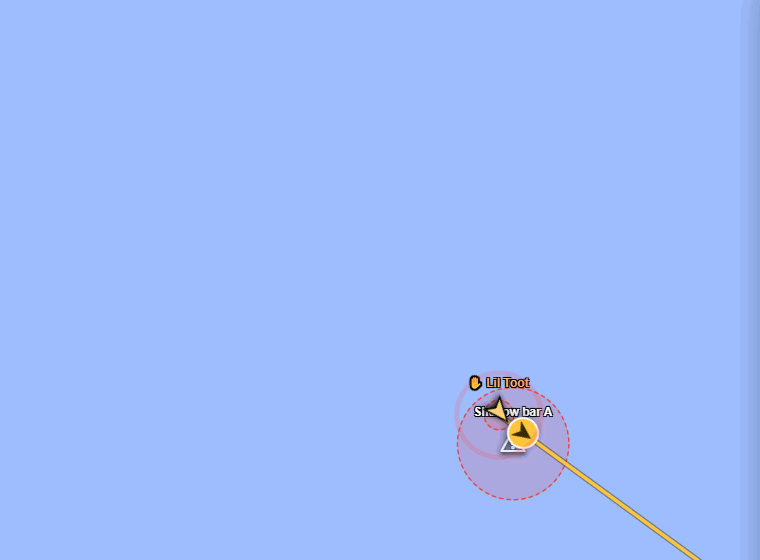
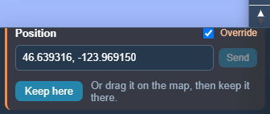
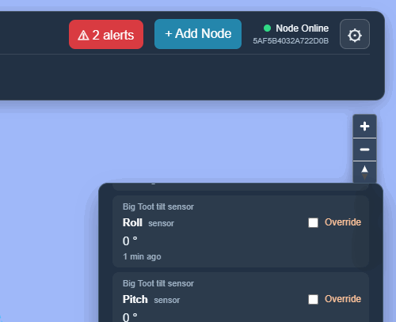

# Manual override

[← Guide](README.md)

Manual override lets you take over one reading, such as a vessel's position,
its heading or a tilt sensor's roll, and set it by hand. It's how you find out
what Undergrowth would do if the boat tipped over, without tipping the boat
over.

Nothing else is faked. While a value is overridden, the map and missions use
what you set, but the real sensor keeps reporting and its readings are still
recorded. The value is marked ✋ *set by hand* everywhere it appears, including
in alerts and logs, so a test can't be mistaken for the real thing.

Untick *Override* and the value goes straight back to the real reading. A
vessel jumps back to where its GPS says it is:

## How to use it

1. Click a vessel (or anything else) on the map.
2. In **Controls**, tick **Override** next to the reading you want to set.
3. Change it:
   - **Position:** drag the marker on the map, or type `latitude, longitude`
     and press **Send**.
   - **Numbers:** drag the slider (it sends when you let go), or type a number
     and press **Send**. Typed numbers are never sent while you are still
     typing.
4. Untick **Override**, or press **Release all**, to go back to real readings.

**Override all** ticks every sensor and position in the panel at once.

Only the computer that owns a record can override it. On a copy from another
computer the override boxes are greyed out (see
[Sharing between computers](sharing.md)).

## Moving something for good

Override is for trying things out. When you have dragged something to where it
really belongs (a dock you placed in the wrong spot, a basket that has been
moved), press **Keep here** under its position. The new spot becomes its saved
position, the override ends, and the move is written to Logs.

For a vessel, **Keep here** appears under its GPS's position, because that is
where a vessel's position comes from. Something whose position comes from live
GPS telemetry cannot be kept somewhere else: the next GPS reading would move it
back.

## Example: testing a capsize

Override *Big Toot*'s roll, set it to 60°, and three seconds later the
[tipping watch](safety-watches.md) raises an alert, marked *(set by hand)*:

Every override turned on or off is written to [Logs](logs-and-history.md) under
*override*, and every hand-set value is kept as a reading.
