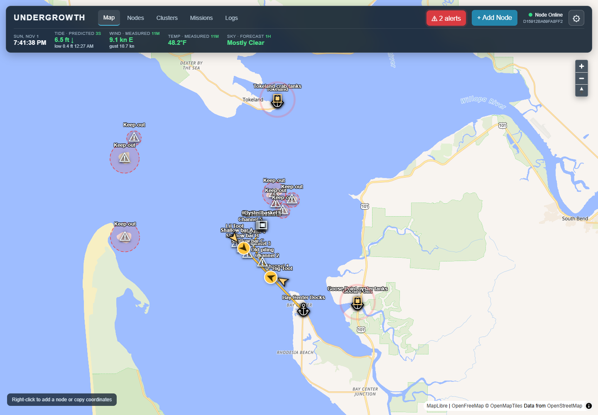
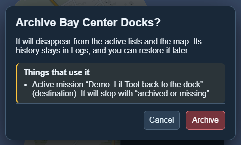

# The map and conditions

[← Guide](README.md)

The map is the main screen. Everything with a position and *Show on map* ticked
appears on it: ports, vessels, waypoints, keep-outs, baskets and tank houses.

## Conditions along the top

The bar shows the conditions **at the centre of the map**. Pan the map and they
follow.

| Reading | Where it comes from |
|---|---|
| **Tide** | NOAA tide predictions for the nearest station (Bay Center / Palix River), with the next high or low. |
| **Wind** | Measured at the nearest NOAA station (Toke Point) when there is one within 50 km, otherwise the National Weather Service forecast. |
| **Temp** | Same as wind: measured if possible, forecast if not. |
| **Sky** | National Weather Service hourly forecast. |

Each reading says whether it is a **prediction**, a **measurement** or a
**forecast**, and how old it is. Hover over a reading for the exact station and
times.

### The colours mean "how fresh"

Every value fades from **bright green** (just arrived) to **dull brown** (old).
A brown reading is still shown, but you can see at a glance not to trust it as
much. If the service cannot reach NOAA or the Weather Service, the bar says
*Conditions offline* and the last values keep fading.

## Clicking things

- **Click** a marker to open its panel on the right (its details, its mission
  advice and its controls).
- **Right-click** the map to add a node, a keep-out or a waypoint at that spot,
  or to copy the coordinates.
- **Right-click** a marker to edit or archive it.
- When markers sit on top of each other, a small list asks which one you meant.
- The ⧉ button next to any ID or coordinates copies it.

Archiving always asks first and lists anything that depends on the record, such
as a mission heading there:

Archived records disappear from the map but nothing is deleted; they can be
restored from the Nodes, Clusters or Logs pages.
