# Map

[← Guide](README.md) · **Map** · [Nodes](nodes.md) · [Clusters](clusters.md) · [Missions](missions.md) · [Scenarios](scenarios.md) · [Graphs](graphs.md) · [Logs](logs.md) · [Data](data.md)

The map is the main screen. Everything with a position and *Show on map* ticked
appears on it: ports, vessels, waypoints, keep-outs, baskets and tank houses.

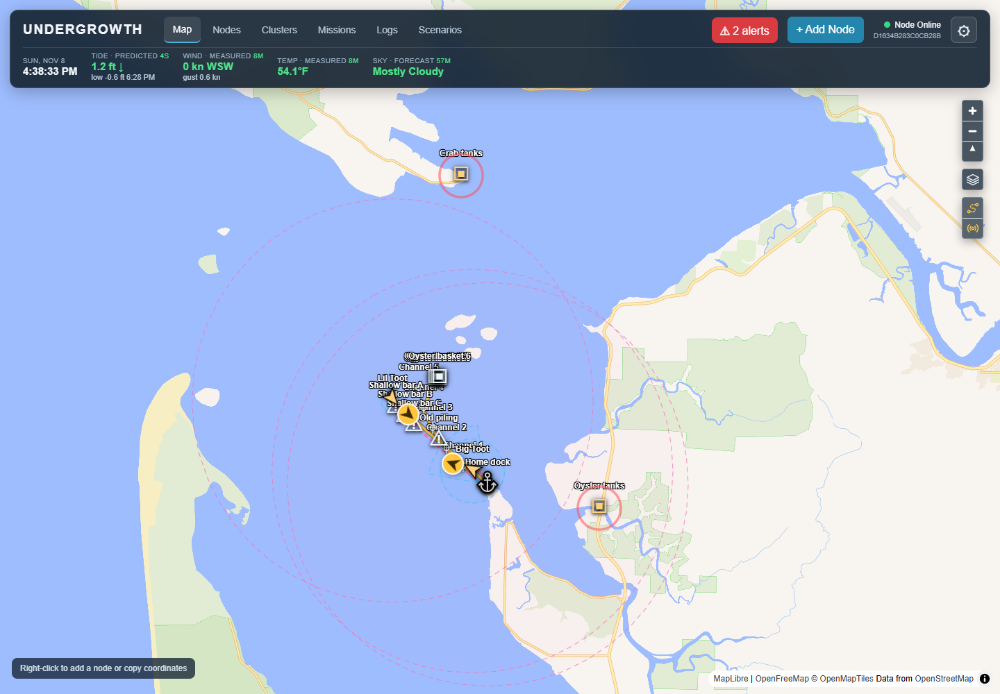

## Conditions along the top

The bar shows the conditions **at the centre of the map**. Pan the map and they
follow.

| Reading | Where it comes from |
|---|---|
| **Clock** | The time at the Undergrowth computer, with its time zone (*PST*). Clock times in missions use this zone. If your device is in another zone, hovering over the clock says so. |
| **Tide** | NOAA tide predictions for the nearest tide station, with the next high or low. |
| **Wind** | Speed and gusts in mph, with an arrow pointing the way the wind blows (a south wind points north). Hover for the direction it comes from and the speed in knots. Measured at the nearest NOAA station when there is one within 50 km, otherwise the National Weather Service forecast. |
| **Temp** | Same as wind: measured if possible, forecast if not. |
| **Sky** | National Weather Service hourly forecast. |

Each reading says whether it is a **prediction**, a **measurement** or a
**forecast**, and how old it is. Hover over a reading for the exact station and
times.

### The colours mean "how fresh"

Every value fades from **bright green** (just arrived) to **dull brown** (old).
A brown reading is still shown, but it's a sign not to trust it as much. If the
service cannot reach NOAA or the Weather Service, the bar says *Conditions
offline* and the last values keep fading.

## Map symbols

| Symbol | Meaning |
|---|---|
| 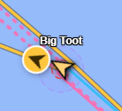 | A vessel. The arrow points the way it is heading. The small dashed circle is how far other vessels keep away. |
| 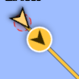 | Mission advice. The gold circle shows which way the mission says to go, and the gold line is the planned path. |
| 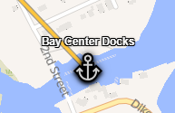 | A port or dock. |
| 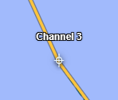 | A route waypoint. Routes are dashed blue lines between their waypoints. |
| 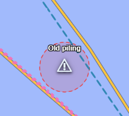 | A keep-out, such as an old piling or a sandbar. Vessels steer around the red circle. |
| 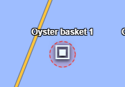 | An oyster basket. Vessels that aren't collecting it keep a small distance. |
| 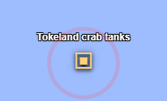 | A tank house, holding a group of tanks. A pulsing ring means one of its tanks has an alert. |
| 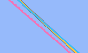 | Radio connections. Solid is connected, dotted is in range but not connected, and the colour is the kind of radio. See [Radios and connections](radios-and-connections.md). |
| 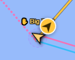 | ✋ Set by hand. An orange name with a hand means part of it is under [manual override](manual-override.md). |

## Map styles

The layers button under the zoom buttons switches the background map. Your
choice is remembered on each device.

| Style | Good for | Source |
|---|---|---|
| **Map** | Everyday use: roads, place names, shoreline. | OpenFreeMap (OpenStreetMap) |
| **Satellite** | Seeing beds, channels and mudflats as they look from the air. | USGS aerial imagery |
| **Nautical chart** | Depths, channel markers and navigation aids. | NOAA charts (not for navigation) |
| **Topographic** | Elevation contours and terrain around the shore. | USGS topo maps |

Markers, routes, keep-outs and mission paths stay on top whichever style is
chosen. The satellite and topographic maps cover the United States only and
become slightly blurry at the closest zoom levels.

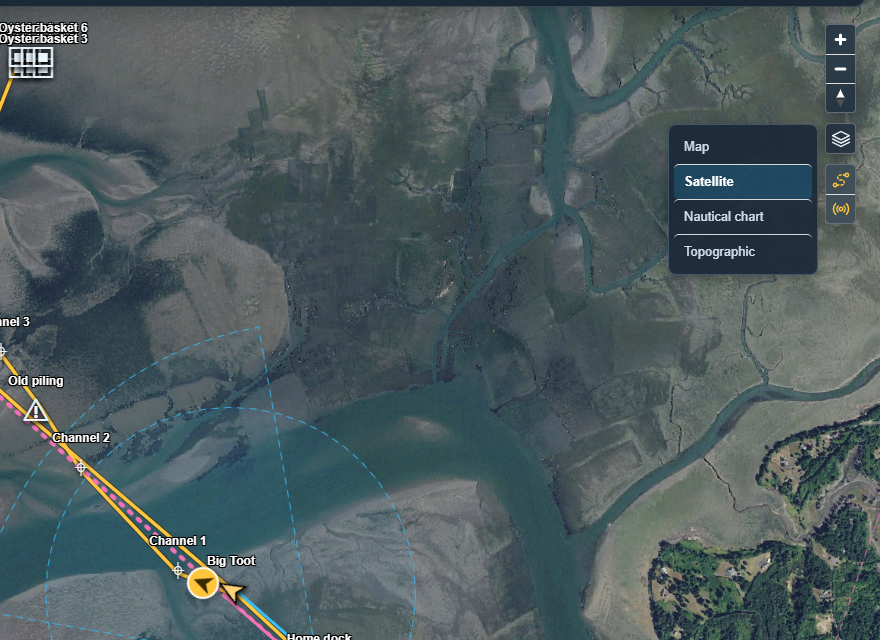

### The nautical chart

NOAA's chart shows depth soundings, channels, buoys and lights, with the farm
on top. Here Big Toot's planned path follows the channel waypoints past the old
piling, and the dock's radios reach out to it:

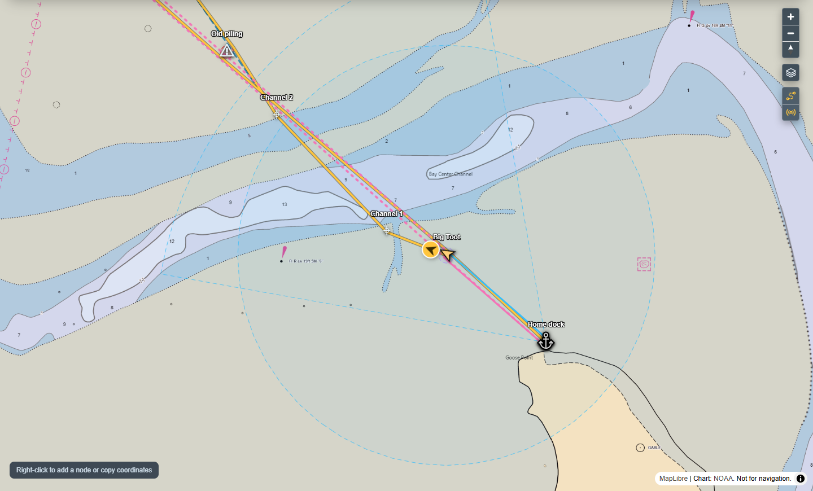

## Map buttons

Under the zoom buttons, from the top:

- **Map style**: the menu above.
- **Routes**: show or hide every route, with its waypoints.
- **Connections**: show or hide radio connections and how far each radio
  reaches (see [Radios and connections](radios-and-connections.md)).

A lit button means that layer is showing. Each device remembers its choices.

## Clicking things

- **Click** a marker to open its panel on the right: its details, its mission
  advice and its controls. What a panel holds is covered under
  [Nodes](nodes.md) and [Clusters](clusters.md).
- **Right-click** the map to add a node, a keep-out or a waypoint at that spot,
  or to copy the coordinates.
- **Right-click** a marker to edit or archive it.
- When markers sit on top of each other, a small list asks which one you meant.
- The ⧉ button next to any ID or coordinates copies it.

Archiving always asks first and lists anything that depends on the record, such
as a mission heading there:

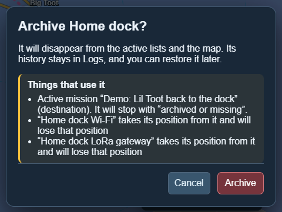

Archived records disappear from the map but nothing is deleted; they can be
restored from the Nodes, Clusters or Logs pages.

Records copied from another computer show on the map like any other, but
their panel says which computer they came from, and they can't be dragged,
edited or archived here. See [Sharing between computers](sharing.md).
