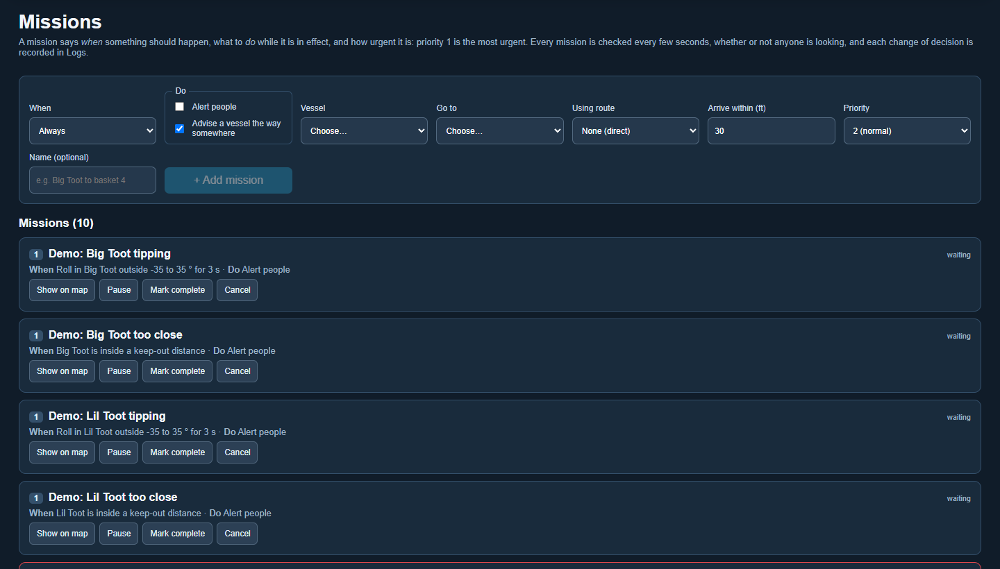
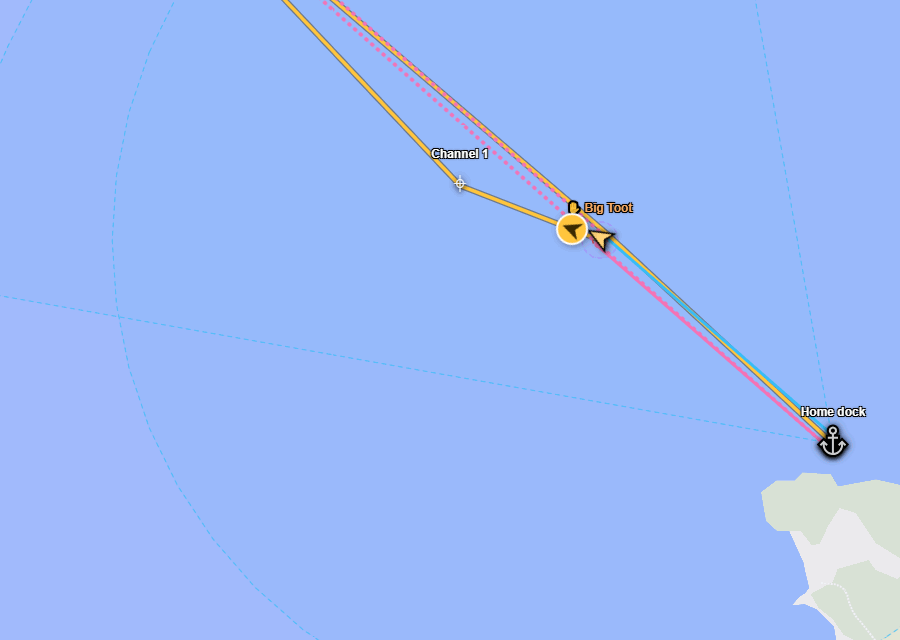
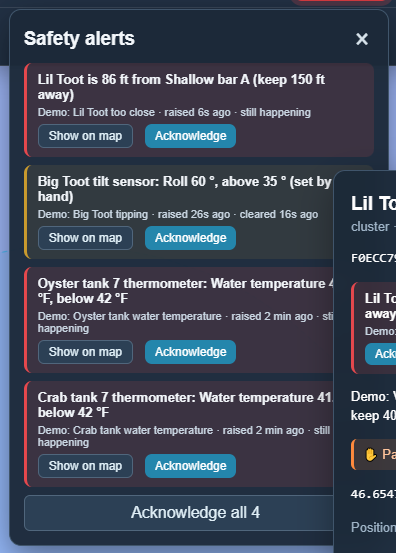
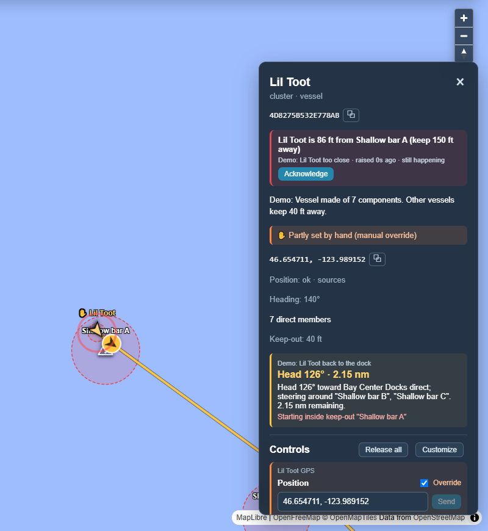

# Missions

[← Guide](README.md) · [Map](map.md) · [Nodes](nodes.md) · [Clusters](clusters.md) · **Missions** · [Scenarios](scenarios.md) · [Graphs](graphs.md) · [Logs](logs.md) · [Data](data.md) · [Reports](reports.md)

A mission is **a goal**, not a list of steps. "Take Big Toot to basket 4."
"Tell someone if a crab tank drops below 42 °F." Every 5 seconds, whether or
not anyone has the dashboard open, Undergrowth checks each mission against what
is happening right now, and writes each change of decision to [Logs](logs.md)
with the reason.

There is only one kind of mission. Every mission has three parts:

| Part | What it is | Examples |
|---|---|---|
| **When** | What has to be true for the mission to be in effect. | Always. Between two times of day. A reading goes out of range. A vessel gets too close to a keep-out. A sensor stops reporting. |
| **Do** | What it does while in effect. | Set a control (a light, a pump, a fan). Alert people. Advise a vessel the way somewhere. |
| **Priority** | How urgent it is. **1 is the most urgent.** | Alarms are 1 unless you choose otherwise. Everything else is 2. |

An alarm isn't a separate feature. It's a mission whose *do* is "alert
people", and the same goes for navigation. See
[Fundamental logic](fundamental-logic.md) for why it works this way, and what
comes next.

## The Missions page

The form at the top builds a mission. Choose the **When**, tick what to
**Do**, and the fields for each appear. The list below shows every mission,
most urgent first, with its priority in a small box, its *when* and its *do*,
and whether it's in effect right now.

- **Pause** stops a mission without losing it, and **Resume** starts it again.
- **Mark complete** and **Cancel** finish it. The most recent finished
  missions are listed at the bottom with **Reactivate**. Everything any
  mission did stays in [Logs](logs.md).
- **Show on map** goes to the vessel or thing the mission is about.

## Setting a control

A control is a value Undergrowth sets: a light's brightness, a pump or a fan
switched on or off (see [Nodes](nodes.md#easing-and-confirming)). A mission can
set one or more of them while it is in effect. Pointed at a cluster, it sets
every part inside that has that control: "everything in the greenhouse,
brightness to 0 %".

A number can **ease** over some minutes: "ease the lights to 20 % over 60
minutes". The command is one message, and the device does the easing itself.
On/off controls just switch.

**Between two times of day** is a *when* for schedules: "06:00 to 18:00" is in
effect all day, and "18:00 to 06:00" runs past midnight. The times are the
Undergrowth computer's, in the time zone shown by the clock in the top bar.

### Which mission gets a control

When several missions in effect want the same control, the **most urgent**
(the lowest priority number) gets it. Each mission's card says, for each
control, whether it is **in charge**, **overruled** by another mission, or not
in effect.

| Mission | Priority | When | Do |
|---|---|---|---|
| Overheat | 1 | Temperature above 85 °F | Everything in the greenhouse to 0 %; fan on; alert people |
| Lights on | 2 | 06:00 to 18:00 | Ease the lights to 20 % over 60 minutes |
| Lights off | 2 | 18:00 to 06:00 | Ease the lights to 0 % over 60 minutes |

At 14:00 the greenhouse overheats: *Overheat* gets the lights and they go
off. At 14:20 it has cooled down, *Overheat* ends, and *Lights on* gets the
lights back, easing them up to 20 %. Nothing had to remember what the lights
were before.

- **A command goes out once,** when the decision changes: a different mission
  in charge, or a mission wanting something different. Undergrowth doesn't
  keep repeating it.
- **When no mission wants a control any more, it stays as it is.** Above, the
  fan stays on after *Overheat* ends. A mission that switches the fan off (say,
  "temperature below 75 °F") would turn it off.
- **A person's command stands** until the missions decide something new. The
  card shows the mission is in charge but the control was set by hand since.
- **Two missions at the same priority** that want a control set differently:
  the one in effect first keeps it, and the clash is written to
  [Logs](logs.md), so one of them can be given another priority.
- **If a device can't be reached,** the mission says why on its card, writes it
  to Logs once, and tries again every minute.

Every command a mission sends is written to [Logs](logs.md) with the
mission's name.

## Advising a vessel

A mission that advises a vessel says "get this vessel to that place",
optionally by way of a route, and how close counts as arrived. Its *when* is
usually *Always*.

The advice shows in the vessel's panel and on the map: a gold circle pointing
the way to go and a gold line for the planned path.

### Routes and keep-outs

- A **route** is a [cluster](clusters.md) of waypoints. Their order does not
  matter: Undergrowth joins them with the shortest set of connections (the
  dashed blue lines).
- A **keep-out** is any [node](nodes.md) with a *keep-out distance*. Hazards,
  baskets and vessels all have one. Missions bend their path around keep-out
  circles.

A route is only used when it helps. Near the route, the plan joins it and
follows it. Out in open water, far from it, the plan heads straight for the
target instead.

### Worked out fresh from where the boat is now

Missions do not remember where a vessel was supposed to be. Every few seconds
the plan is worked out again from **where the vessel is now**, so you can pick a
vessel up, put it down anywhere, and the advice follows:

(Dragging needs the vessel's position to be under [manual override](manual-override.md).)

When the vessel is close enough, the advice changes to **Arrived — hold
position**. The mission doesn't finish by itself: press **Mark complete** when
the job is done.

When the decision changes (a new heading, a new next waypoint, a keep-out to
avoid, arriving), the reason and the inputs it was based on are written to
[Logs](logs.md).

The *Boat to a basket* [scenario](scenarios.md) has one boat, one route and one
keep-out to try all of this on.

## Alerting people

A mission that alerts people raises an alert for each thing that makes its
*when* true. A tank house with two cold tanks gets two alerts, one per tank.

| When | Is true when | Example in *The whole farm* |
|---|---|---|
| **A reading goes out of range** | a number goes below a low limit or above a high limit. Pointed at a cluster, it covers every part inside that has that reading. | Water temperature outside 42–60 °F in every crab tank; roll beyond ±35° on each vessel. |
| **Gets too close** | a vessel comes inside any keep-out distance: hazards, baskets, and other vessels. It ignores the vessel's own parts and wherever a mission is sending it. | Lil Toot too close to a sandbar. |
| **A sensor stops reporting** | real readings stop arriving for a number of minutes (a dead thermometer battery). An override never hides a silent sensor. | Tank thermometers silent for 3 hours. |

**Only if it lasts** makes the *when* wait a few seconds before it counts, so a
wave rocking the boat for a moment is not a capsize.

**Only between two times of day** limits it to part of the day. "Between 06:00
and 18:00, the light sensor reads below 50 lux for 15 seconds" alerts someone
when the grow lights should be on but nothing sees them: a blown bulb, a
tripped breaker, a command that never arrived. At night the same darkness is
expected, so it stays quiet.

### What an alert looks like

- **Top bar:** a red **⚠ alerts** button. It flashes until someone acknowledges
  the alert, stays red while the problem continues, and turns amber once it has
  cleared but still needs acknowledging.
- **Map:** a pulsing ring at the spot.
- **Panels:** the alert at the top of the panel, and the tank or vessel flagged
  in red in the panel of whatever contains it (a tank in its tank house).

**Show on map** goes to the thing the alert is about. For a hidden part such as
a tank's thermometer, it opens the tank.

An alert stays until a person presses **Acknowledge**, even after the problem
has gone away, so nothing is missed because it fixed itself. Pausing or
finishing the mission clears its alerts, and they still wait to be
acknowledged.

### Testing an alert

Use [manual override](manual-override.md): drag a vessel into a keep-out, set a
roll of 60°, or set a tank's water temperature to 38 °F, and watch the alert
appear, marked *(set by hand)*. Set it back, or release the override, and the
alert turns amber until someone acknowledges it. The *Capsize test*, *Crab tank
goes cold* and *Rescue* [scenarios](scenarios.md) each set one up to try.

Every alert, clearing and acknowledgement is written to [Logs](logs.md) under
*safety*, with the readings that caused it.
