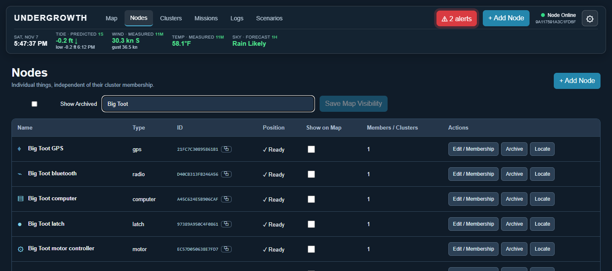
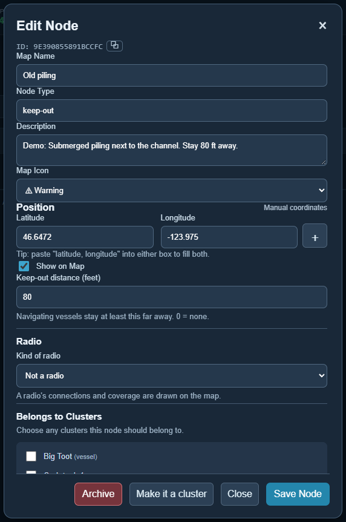
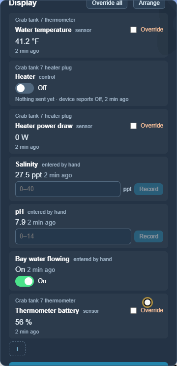
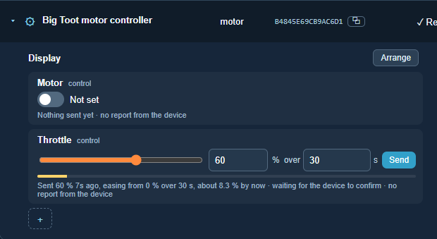
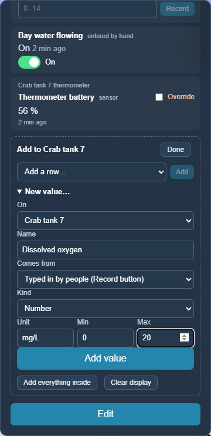

# Nodes

[← Guide](README.md) · [Map](map.md) · **Nodes** · [Clusters](clusters.md) · [Missions](missions.md) · [Scenarios](scenarios.md) · [Graphs](graphs.md) · [Logs](logs.md) · [Data](data.md) · [Reports](reports.md)

## What a node is

A node is **one thing**: a GPS, a heater plug, a floating thermometer, an
oyster basket, a dock, a sandbar to stay away from. Everything Undergrowth
knows about starts as a node.

A node has:

- **a name and an ID.** The name is for people and can change. The ID never
  changes, so its readings, missions and history stay attached to it.
- **a place,** if it has one. A dock has coordinates. A heater plug takes its
  place from the tank it's in. A basket on the bottom has a spot on the map.
- **values:** things it reports, things people measure and type in, and things
  Undergrowth can switch or set. A thermometer reports water temperature and
  battery. A heater plug can be switched on and off, and reports how much power
  it is drawing.

That's all a node is. Its *type* (gps, relay, keep-out, port…) is a word to help
people, not a set of rules. Any node can have any values, much like a part with
inputs and outputs that you wire up however the job needs.

### Why everything starts as a node

A farm changes. A dock starts as a place to tie up. Later it gets Wi-Fi, then a
camera, then a heater for the holding tanks. Undergrowth doesn't make you
describe all of that up front.

Add what you have now, as a node. When it grows parts, **Make it a cluster** in
its editor turns it into a [cluster](clusters.md) that can hold them. It keeps
its ID, readings, missions and history, and anything already mounted on it
becomes its first parts.

The computer running Undergrowth is a node too, so it shows up alongside
everything else. That one can't be archived or made a cluster.

### Every value says how old it is

Every reading keeps the time it was taken. On screen, values fade from **bright
green** (just arrived) to **dull brown** (old), so a stale reading looks stale.
A position that stops updating fades the same way, and after a while a node
whose position comes from GPS is marked as having no position at all, rather
than pretending to be where it was last seen.

### How it's connected

A node can say what it is plugged into, and how. Its display then starts with
the whole way its readings travel, one hop at a time:

```
Bench 7330 VEML7700 ─I2C 0x10→ Bench 7330 ESP32-S3 ─Wi-Fi · 3 s ago→ This computer
```

- **A board says what is plugged into it.** An Undergrowth ESP32 board looks on
  its I2C port every few seconds. A sensor it knows appears as a node of its
  own within a few seconds, already wired to the board (see
  [Sharing](sharing.md#the-computers-on-a-boat)).
- **For anything else, say it yourself.** In a node's editor, **Connected
  through** picks what it is plugged into, and **How** says how: I2C, USB, a
  pin, a cable.
- **The last hop comes from sharing.** For a board or computer this one shares
  with, it shows how long ago it last answered, in amber when it has gone quiet.

Being connected is not the same as belonging. A sensor wired to a board can
sit in a greenhouse cluster, while the board sits in a cluster with everything
else plugged into it.

## The Nodes page

**Nodes** in the top bar lists every node, whether it is on the map or hidden
inside something else.



- **Search** by name, type or ID. Here, searching *Big Toot* finds the boat's
  parts: its GPS, radios, computer, latch, motor controller and so on.
- **Position** says whether its place is known: *✓ Ready*, *⚠ Partial* (some
  of what it takes its place from is missing; hover for why) or *—
  Unavailable*.
- **Show on Map**: tick or untick, then press **Save Map Visibility**. Parts
  inside a boat or a tank are usually hidden, so the map shows the boat, not
  its bolts.
- **Members / Clusters** is how many clusters the node belongs to.
- **Edit / Membership** opens its editor, **Archive** puts it away, and
  **Locate** shows it on the map.
- **Show Archived** brings archived nodes back into the list, with **Restore**.
- **▸** beside a name opens its [display](#displays) underneath, the same
  one the map shows.

**+ Add Node** makes a new one. On the map, right-clicking a spot does the same
with its coordinates already filled in.

## The editor



- **Map Name, Node Type, Description, Map Icon.** The type is free text, with
  the types you've already used offered as you type.
- **Position**, from one of three places:
  - **manual coordinates**: type them in, or paste `latitude, longitude`;
  - **other nodes or clusters**: press **＋** and tick where it gets its place
    from. A heater plug takes the place of its tank; every part of a boat takes
    the place of the boat's GPS. Several sources are averaged.
  - **GPS telemetry**: its own GPS readings, ignored once they are older than
    you say.
- **Show on Map.**
- **Keep-out distance**: how far boats stay away. Anything with a keep-out
  distance is a keep-out: an old piling, a sandbar, a basket, another boat. See
  [Missions](missions.md).
- **Radio**: what kind of radio it is, if any, and how far it reaches. See
  [Radios and connections](radios-and-connections.md).
- **Belongs to Clusters**: tick the clusters it is part of. A node can belong to
  more than one: a thermometer is part of its tank, and the tank is part of the
  tank house.
- **Archive** and **Make it a cluster** at the bottom.

Every change is written to [Logs](logs.md).

<br clear="right">

## Values

A value can be shown as a row on a [display](#displays). Each row works
according to where the value comes from:

| Kind | Example | What the row lets you do |
|---|---|---|
| **sensor** | water temperature, GPS heading, heater power draw | Shows the latest reading and how old it is. Tick *Override* to set it by hand for testing. |
| **entered by hand** | salinity, pH, "bay water flowing" | People measure it and type it in: enter the number and press **Record**. |
| **control** | heater plug, motor, latch, grow light | A switch, a slider with **Send**, or a one-press button. Undergrowth sends the command; the row shows what was sent, whether the device confirmed it, and what the device last reported. A number can be [eased](#easing-and-confirming). |

Typed numbers are only sent when you press **Send** / **Record** or Enter, so
`256` is never sent as `2`, `25`, `256`.

Switching a heater on and recording a salinity reading:



In a scenario no real plug is connected, so the row says *Sent On · device
reports Off*. With a real plug, the device's report would follow.

### Easing and confirming

A number control, such as a throttle or a grow light's brightness, has an
**over … s** box beside **Send**. Leave it empty to set the new value at once,
or give a time to ease to it gradually: a motor that spins up gently, lights
that fade up like a sunrise.

Easing is **one message**: "ease from 0% to 60% over 30 seconds". Undergrowth
doesn't send 1%, 2%, 3%… The device (an ESP32, or the computer's own pins)
works out the steps itself, along one smooth curve that starts and ends
gently. A new command always takes over straight away, even halfway through
an ease, so a stop is never held up. An ease starts from wherever the last one
should have got to.

While it eases, a thin gold bar and the line under the control show where it
should have got to by now. That's what was asked for, not a reading: what the
device actually reports is shown after it.



A device can **confirm** each command. The line under the control says
*waiting for the device to confirm*, then *confirmed*, or *not confirmed* if
nothing comes back. Nothing ever waits for an answer: a missing confirmation
is information, which a mission could act on. Every command and confirmation
is written to [Logs](logs.md) under *command*. In a scenario no real device is
connected, so commands stay *not confirmed*.

Switches, text and buttons can't be eased; they change at once.

Any sensor reading or position can be set by hand for testing with
[manual override](manual-override.md).

## Displays

Every node and cluster has a **display**: the rows shown under it. It is the
same display wherever you look, whether you click it on the map or open it
with **▸** in the Nodes or Clusters list, so something with no position at all
can still be watched and controlled from the lists.

A display **starts blank**. You decide what each thing shows: a GPS might show
just its position and heading, a motor controller what the motor is doing, and
the boat both.

**＋** at the bottom of a display:

- **Add a row**: a reading or control from the node itself, or from anything
  inside it. For a cluster, it can also be another cluster or node inside it,
  which opens underneath with its own display (see
  [Clusters](clusters.md#a-clusters-display)).
- **Add everything inside**: everything at once, to trim down afterwards.
- **New value…**: give it a name, say whether people type it in, a sensor
  reports it, or Undergrowth controls it, and give a unit and range. It goes
  straight onto the display.

**Arrange** moves rows up and down (↑ ↓) or removes them (✕). Removing a row
only takes it off the display: the value and its readings stay. Changes save
straight away, and which displays are open is remembered on each device.



## Who can change a node

The computer that created a node owns it. Other computers running Undergrowth
hold a read-only copy: it looks the same on their map, but its controls are
greyed out. See [Sharing between computers](sharing.md).
