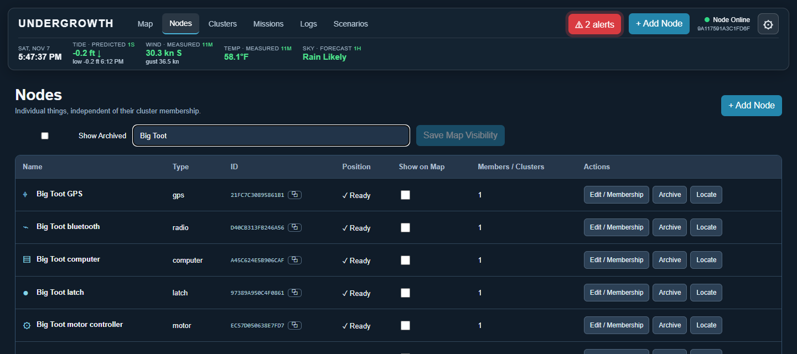
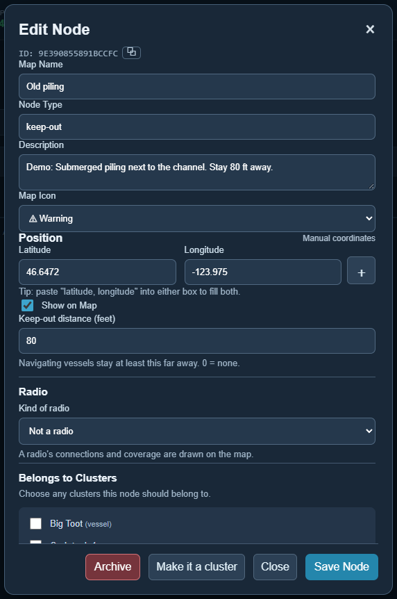
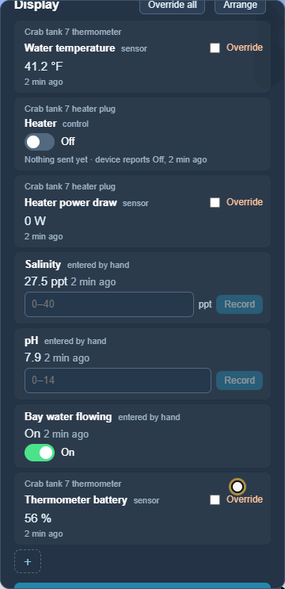
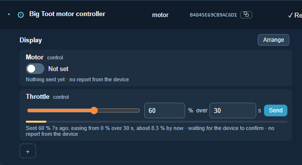
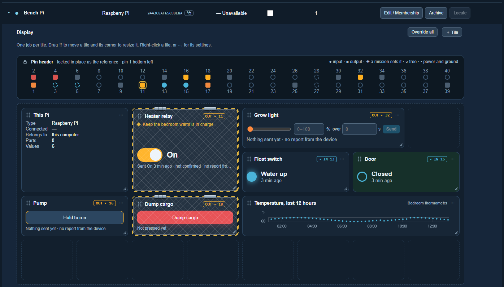
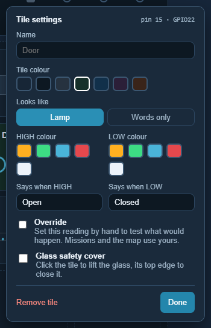
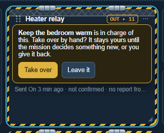
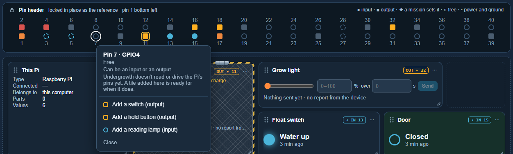

# Nodes

[← Guide](README.md) · [Map](map.md) · **Nodes** · [Clusters](clusters.md) · [Missions](missions.md) · [Scenarios](scenarios.md) · [Graphs](graphs.md) · [Logs](logs.md) · [Data](data.md) · [Reports](reports.md)

## What a node is

A node is **one thing**: a thermometer, a heater plug, a grow light, a GPS, a
door, an oyster basket, a sandbar a boat has to stay away from. Everything Undergrowth
knows about starts as a node.

A node has:

- **a name and an ID.** The name is for people and can change. The ID never
  changes, so its readings, missions and history stay attached to it.
- **a place,** if it has one. A building or a dock has coordinates. A heater
  plug takes its place from the room or tank it's in. A basket on the bottom
  of a bay has a spot on the map.
- **values:** things it reports, things people measure and type in, and things
  Undergrowth can switch or set. A thermometer reports water temperature and
  battery. A heater plug can be switched on and off, and reports how much power
  it is drawing.

That's all a node is. Its *type* (gps, relay, keep-out, port…) is a word to help
people, not a set of rules. Any node can have any values, much like a part with
inputs and outputs that you wire up however the job needs.

### Why everything starts as a node

A project changes. A shed starts as a place to keep tools. Later it gets Wi-Fi,
then a camera, then a heater. A dock on a farm grows the same way. Undergrowth
doesn't make you describe all of that up front.

Add what you have now, as a node. When it grows parts, **Make it a cluster** in
its editor turns it into a [cluster](clusters.md) that can hold them. It keeps
its ID, readings, missions and history, and anything already mounted on it
becomes its first parts.

The computer running Undergrowth is a node too, so it shows up alongside
everything else. That one can't be archived or made a cluster.

### Every value says how old it is

Every reading keeps the time it was taken. On screen, values fade from **bright
green** (just arrived) to **dull brown** (old), so a stale reading looks stale.
A position that stops updating fades the same way, and after a while a node
whose position comes from GPS is marked as having no position at all, rather
than pretending to be where it was last seen.

### How it's connected

A node can say what it is plugged into, and how. Its display then starts with
the whole way its readings travel, one hop at a time:

```
Bench 7330 VEML7700 ─I2C 0x10→ Bench 7330 ESP32-S3 ─Wi-Fi · 3 s ago→ This computer
```

- **A board says what is plugged into it.** An Undergrowth ESP32 board looks on
  its I2C port every few seconds. A sensor it knows appears as a node of its
  own within a few seconds, already wired to the board (see
  [Sharing](sharing.md#a-pi-a-phone-and-a-board)).
- **A Bluetooth sensor is wired to the computer that hears it,** once it is
  added (see [Bluetooth sensors](#bluetooth-sensors)).
- **For anything else, say it yourself.** In a node's editor, **Connected
  through** picks what it is plugged into, and **How** says how: I2C, USB, a
  pin, a cable.
- **The last hop comes from sharing.** For a board or computer this one shares
  with, it shows how long ago it last answered, in amber when it has gone quiet.

Being connected is not the same as belonging. A sensor wired to a board can
sit in a greenhouse cluster, while the board sits in a cluster with everything
else plugged into it.

## The Nodes page

**Nodes** in the top bar lists every node, whether it is on the map or hidden
inside something else.



- **Search** by name, type or ID. Here, searching *Big Toot* finds the boat's
  parts: its GPS, radios, computer, latch, motor controller and so on.
- **Position** says whether its place is known: *✓ Ready*, *⚠ Partial* (some
  of what it takes its place from is missing; hover for why) or *—
  Unavailable*.
- **Show on Map**: tick or untick, then press **Save Map Visibility**. Parts
  inside a boat or a tank are usually hidden, so the map shows the boat, not
  its bolts.
- **Members / Clusters** is how many clusters the node belongs to.
- **Edit / Membership** opens its editor, **Archive** puts it away, and
  **Locate** shows it on the map.
- **Show Archived** brings archived nodes back into the list, with **Restore**.
- **▸** beside a name opens its [display](#displays) underneath, the same
  one the map shows.

**+ Add Node** makes a new one. It starts by scanning: boards plugged in by USB
or heard on Wi-Fi, and Bluetooth sensors in range, in one list, each with
**Add**. Only what isn't added yet is listed.

Beside each name are the ways to reach it: a USB, Wi-Fi or Bluetooth icon, or
a short name such as I2C where there's no icon. Green means it's used, grey
means it isn't. When there's a choice, press an icon to use it (it turns
green) or press it again to stop. Something with only one way to reach it has
that one green already.

The one exception is a board that is added but that nothing has come from
yet. It stays, marked *Added · nothing from it reaches this computer yet*,
with **Change** to choose Wi-Fi. Anything else is **Custom node**, described
by hand. On the map, right-clicking a spot adds a node there, with its
coordinates already filled in.

### Bluetooth sensors

A sensor that broadcasts its readings, such as the Govee H5075 thermometer,
shows up in **+ Add Node** with how strong its signal is and when it was last
heard. **Add** asks for a name and makes it a node with its temperature,
humidity and battery already on its display, wired to this computer over
Bluetooth. Its readings are recorded whenever this computer hears it. Which
sensors and computers work is on
[Hardware compatibility](hardware-compatibility.md#bluetooth-sensors).

## The editor



- **How it talks to this computer**, for a board or computer that's been
  added: its USB and Wi-Fi icons, green for the ones in use. **Change** lets
  you press them to choose again. That goes over the cable, so the board has to
  be plugged in by USB.
- **Map Name, Node Type, Description, Map Icon.** The type is free text, with
  the types you've already used offered as you type.
- **Position**, from one of three places:
  - **manual coordinates**: type them in, or paste `latitude, longitude`;
  - **other nodes or clusters**: press **＋** and tick where it gets its place
    from. A heater plug takes the place of its tank; every part of a boat takes
    the place of the boat's GPS. Several sources are averaged.
  - **GPS telemetry**: its own GPS readings, ignored once they are older than
    you say.
- **Show on Map.**
- **Keep-out distance**: how far boats stay away. Anything with a keep-out
  distance is a keep-out: an old piling, a sandbar, a basket, another boat. See
  [Missions](missions.md).
- **Radio**: what kind of radio it is, if any, and how far it reaches. See
  [Radios and connections](radios-and-connections.md).
- **Belongs to Clusters**: tick the clusters it is part of. A node can belong to
  more than one: a thermometer is part of its tank, and the tank is part of the
  tank house.
- **Archive** and **Make it a cluster** at the bottom.

Every change is written to [Logs](logs.md).

<br clear="right">

## Values

A value can be shown as a tile on a [display](#displays). Each tile works
according to where the value comes from:

| Kind | Example | What the tile lets you do |
|---|---|---|
| **sensor** | water temperature, GPS heading, heater power draw | Shows the latest reading and how old it is. Tick *Override* to set it by hand for testing. |
| **entered by hand** | a meter reading, pH, salinity, "bay water flowing" | People measure it and type it in: enter the number and press **Record**. |
| **control** | heater plug, motor, latch, grow light | A switch, a slider with **Send**, or a one-press button. Undergrowth sends the command; the tile shows what was sent, whether the device confirmed it, and what the device last reported. A number can be [eased](#easing-and-confirming). |

Typed numbers are only sent when you press **Send** / **Record** or Enter, so
`256` is never sent as `2`, `25`, `256`.

Switching a heater on and recording a salinity reading:



In a scenario no real plug is connected, so the tile says *Sent On · device
reports Off*. With a real plug, the device's report would follow.

### Easing and confirming

A number control, such as a throttle or a grow light's brightness, has an
**over … s** box beside **Send**. Leave it empty to set the new value at once,
or give a time to ease to it gradually: a motor that spins up gently, lights
that fade up like a sunrise.

Easing is **one message**: "ease from 0% to 60% over 30 seconds". Undergrowth
doesn't send 1%, 2%, 3%… The device (an ESP32, or the computer's own pins)
works out the steps itself, along one smooth curve that starts and ends
gently. A new command always takes over straight away, even halfway through
an ease, so a stop is never held up. An ease starts from wherever the last one
should have got to.

While it eases, a thin gold bar and the line under the control show where it
should have got to by now. That's what was asked for, not a reading: what the
device actually reports is shown after it.



A device can **confirm** each command. The line under the control says
*waiting for the device to confirm*, then *confirmed*, or *not confirmed* if
nothing comes back. Nothing ever waits for an answer: a missing confirmation
is information, which a mission could act on. Every command and confirmation
is written to [Logs](logs.md) under *command*. In a scenario no real device is
connected, so commands stay *not confirmed*.

Switches, text and buttons can't be eased; they change at once.

Any sensor reading or position can be set by hand for testing with
[manual override](manual-override.md).

## Displays

Every node and cluster has a **display**: a grid of tiles shown under it. It is
the same display wherever you look, whether you click it on the map or open it
with **▸** in the Nodes or Clusters list, so something with no position at all
can still be watched and controlled from the lists. It looks the same on every
computer too, because the display belongs to whoever owns the node (see
[Sharing between computers](sharing.md)).



**One job per tile.** A tile is one switch, one reading or one graph. To see a
button and its graph side by side, add both and move them next to each other.

Something new shows **a tile for each value** inside it, so it can be tried
straight away. Move or change anything, and the display keeps your arrangement
from then on.

### Arranging tiles

- **Move** a tile by dragging **⠿** beside its name, and **resize** it by
  dragging its bottom right corner. Tiles snap to a grid 8 cells wide and
  never overlap.
- **＋ Tile** adds one: a reading or control from the node itself or from
  anything inside it, a graph of a reading, a tile saying what something is
  (its type, what it runs on, how it's connected), or, in a cluster,
  something inside it, summed up, whose own display opens underneath (see
  [Clusters](clusters.md#a-clusters-display)).
- **New value…** under **＋ Tile**: give it a name, say whether people type it
  in, a sensor reports it, or Undergrowth controls it, and give a unit and
  range. It goes straight onto the display.
- **Add everything inside** adds the rest at once, **Start again with a tile
  for each value** goes back to the start, and **Remove every tile** empties
  the display.

Removing a tile only takes it off the display: the value and its readings
stay. Changes save straight away, and which displays are open is remembered on
each device.

On a phone, or in the map's panel, there isn't room for 8 cells, so the tiles
stack in one column, in the same order.

### A tile's settings



Right-click a tile, or press **⋯** on it:

- **Name** and **tile colour**.
- **Looks like**: a switch can be a toggle, a rocker, a lit button, or *hold to
  run*, which is on only while it is held down. An on/off reading can be a lamp
  or just words.
- **Colours and words** for on and off, such as a door that says *Open* and
  *Closed*.
- **Override**: set a sensor's reading by hand to test what would happen. See
  [Manual override](manual-override.md).
- **Glass safety cover**, and **when a mission is in charge of this** (below).
- **Remove tile**.

<br clear="right">

### Glass covers and missions

Any tile can have a **glass safety cover**: a clear pane on two hinges, with a
caution stripe round the tile, so a button like *Dump cargo* can't be pressed
by accident. Click the tile to lift the glass, and its top edge to close it. It
closes again by itself after 3, 5, 10 or 30 seconds, or only by hand, and the
stripe's colour can be changed.

A control that a [mission](missions.md) sets gets glass by itself, and a gold
line saying which mission is in charge. Untick the glass in the tile's settings
to take it off. Changing the control by hand asks first:



After **Take over**, the tile says *By hand · Keep the bedroom warm waits*. The
mission takes the control back the next time it decides something new, and
**Give back** hands it back straight away. Both are written to
[Logs](logs.md). A tile's settings can instead say **never** let a person take
over, or let them take over **straight away**, without asking.

The glass and these rules belong to the display, to stop slips on it. They
don't lock the device itself.

### A Raspberry Pi's pins

A Raspberry Pi's display has its 40-pin header across the top, locked in place
as the reference, with pin 1 at the bottom left. Each pin shows what it is:
power, ground, I2C, free, an input (●) or an output (■), with a gold ring when
a mission sets it. Point at a pin for its name, such as *Pin 11 · GPIO17 ·
Heater relay*, and point at a tile to light up its pin.

Click a pin for more. A free pin can become a switch, a hold button, a dimmer
(on the pins that can dim) or a reading lamp. A pin in use can show its tiles,
add a graph of itself, or stop being used.



*Undergrowth doesn't read or drive the Pi's pins yet. Tiles added from the
header are ready for when it does.*

## Who can change a node

The computer that created a node owns it. Other computers running Undergrowth
hold a read-only copy: it looks the same on their map, but its controls are
greyed out. See [Sharing between computers](sharing.md).
