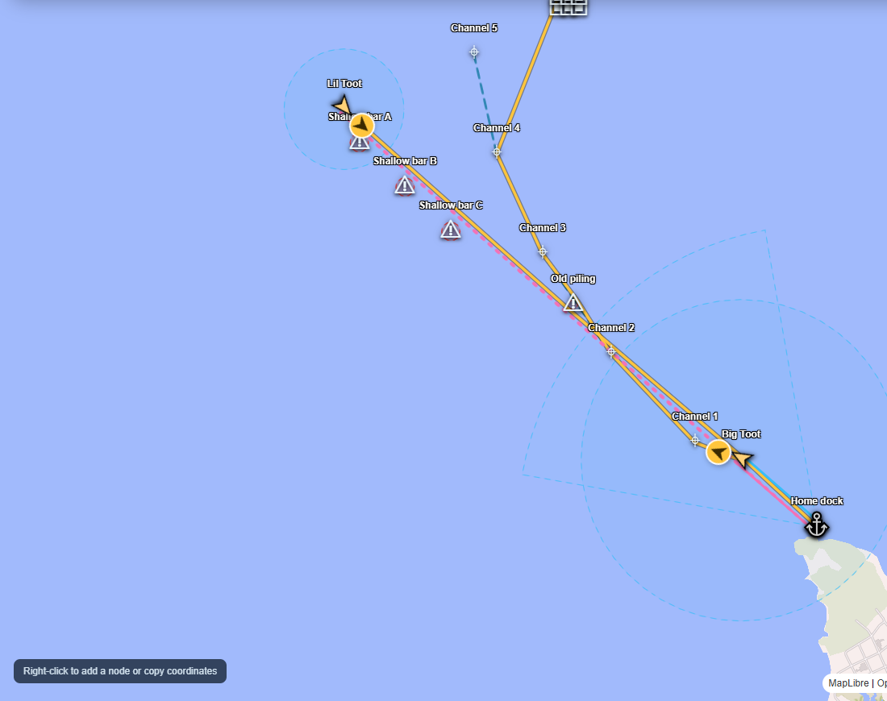
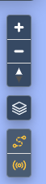
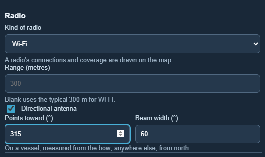
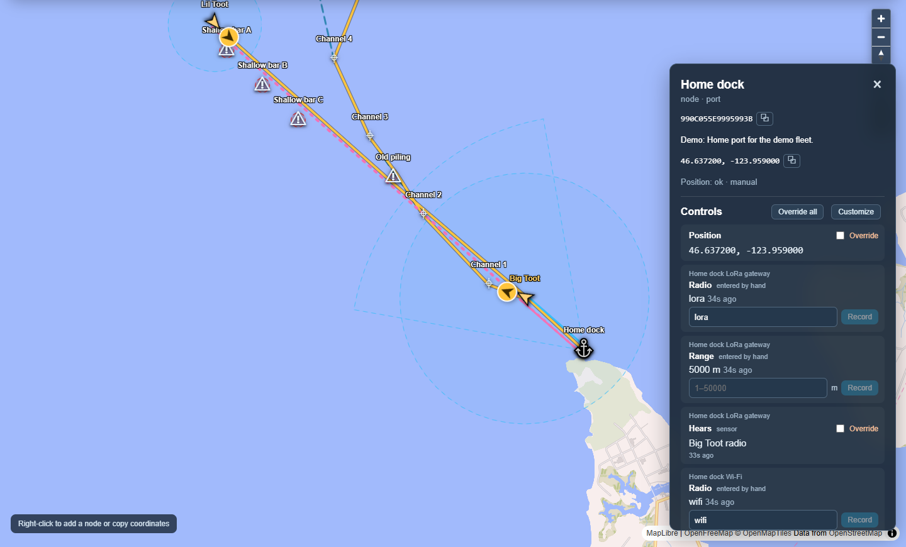

# Radios and connections

[← Guide](README.md)

Undergrowth shows which radios can talk to each other and how far each one is
expected to reach, so you can see when a vessel is out of touch with the dock.

## Showing and hiding

Press the **connections** button under the map's zoom buttons (the one that
looks like a radio signal). While it is lit, the map shows the lines between
radios and a circle around each one for how far it reaches. Press it again to
hide them all. The **routes** button above it does the same for routes and
their waypoints. Each device remembers its choice.

## What the lines and circles mean

| Line | Meaning |
|---|---|
| **Solid** | **Connected.** One of the two radios reported hearing the other. The line fades as that report gets older: full strength for two minutes, faint after half an hour, gone after two hours without a fresh report. |
| **Dotted** | **In range, not connected.** Two radios of the same kind that each reach the other, by their estimated ranges, but neither has reported hearing the other. |

Each **circle** is one radio's estimated reach. A directional antenna is drawn
as a wedge that points the way the antenna faces.

Each kind of radio has its own colour and typical size. When two places are
linked by more than one kind, the lines run side by side.

| Colour | Radio | Typical range |
|---|---|---|
| Blue | Wi-Fi | 300 m |
| Purple | Bluetooth | 30 m |
| Pink | LoRa (long range, low power) | 5 km |
| Green | Zigbee | 50 m |

## Making something a radio

Open the node in the editor (**+ Add Node**, or **Edit** on the Nodes page) and
choose its **Kind of radio**. That is all it takes for it to appear on the map
with its circle and with dotted lines to the radios of the same kind it can
reach.

- **Range** is how far it is expected to reach. Leave it blank for the typical
  range of its kind.
- **Directional antenna**: where it points and how wide its beam is. On a
  vessel the direction is measured from the bow, so the beam turns with the
  boat; anywhere else it is measured from north.

A radio can be its own node on the map (a repeater on a piling), or a hidden
part of something else: a radio mounted on a dock takes its position from the
dock and shows in the dock's panel, so its range can be changed there too.

## Connected or just in range

Each radio has a **Hears** reading: the radios it can hear right now, by name
or ID, separated by commas. Normally the radio reports this itself.

To see what happens when a link drops or appears, tick **Override** next to
**Hears** and type the names it should hear (or clear it). This is
[manual override](manual-override.md), so the change is marked *set by hand*
and the real reports keep being recorded.

In *The whole farm* scenario, Big Toot hears the dock on both Wi-Fi and LoRa. Lil Toot is within
LoRa range of the dock and of Big Toot but has not connected, so those lines
are dotted.

The *Out of radio range* [scenario](built-in-scenarios.md) takes a boat out of
Wi-Fi reach step by step, so you can watch a link drop while LoRa holds.
