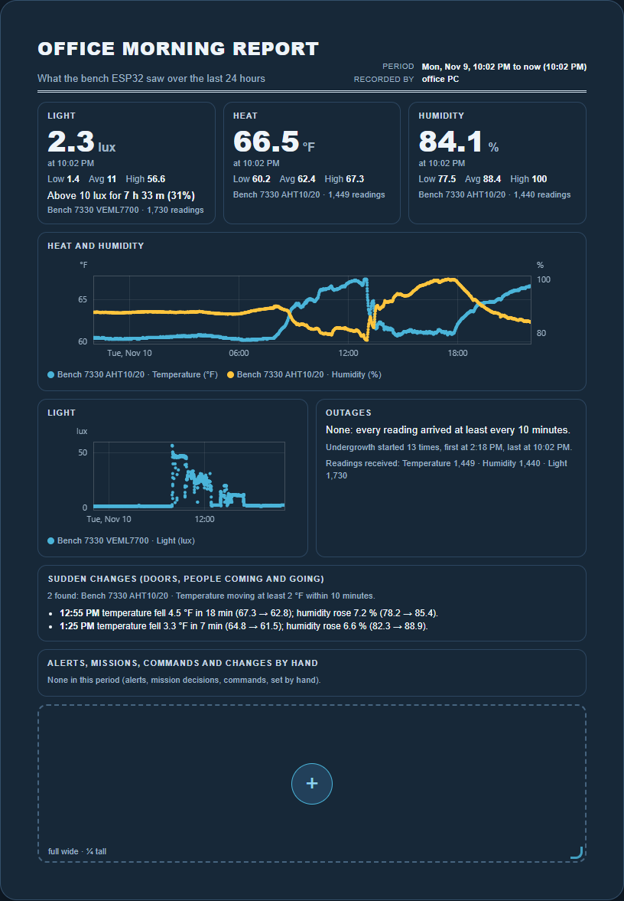
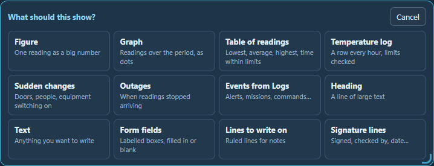

# Reports

[← Guide](README.md) · [Map](map.md) · [Nodes](nodes.md) · [Clusters](clusters.md) · [Missions](missions.md) · [Scenarios](scenarios.md) · [Graphs](graphs.md) · [Logs](logs.md) · [Data](data.md) · **Reports**

The **Reports** page makes Letter-size pages (8.5 × 11 in) that fill
themselves in from the readings and logs. A report is live: it fills in when
you open it and again every 15 seconds. Print it to hand out, or save it as a
PDF.

Here is a morning report on a bench board in an office, covering the last 24
hours: light, heat and humidity, graphs of each, any outages, sudden changes
such as a door opening, and anything from Logs:

## Making a report

Press **+ New report**. A new report is a blank page with one empty tile on
it, marked **+**.

1. **Size the tile.** Drag its bottom-right corner. Width and height snap to
   a quarter, a third, a half, two thirds, three quarters or the whole page,
   and the tile says which while you drag. Drag it very short and it becomes
   as tall as what is in it.
2. **Press +** and choose what it shows:

   

3. **Set it up inside the tile**, such as which readings, and press **Save**.
   The tile becomes the figure, graph, table or sentences, and a new empty tile
   appears after it for the next thing.

Click the title at the top of the page to change it. Point at a tile to move
it earlier or later on the page (◀ ▶), change it (⚙) or remove it (✕). Every
change is saved as you make it.

Along the top of the report:

- **Covers:** today, yesterday, the last 12 or 24 hours, the last 7 or 30
  days, or between two times.
- **Page:** Letter, portrait or landscape.
- **Print in:** colour or black and white.

## What a tile can show

| Tile | What it shows |
|---|---|
| **Figure** | One reading as a big number, with its lowest, average and highest. It can count how long the reading was above or below a level: for light, above 10 lux is how long the lights were on. |
| **Graph** | Readings over the report's period as dots, with alerts, commands, missions and changes by hand marked on it. Choose the readings in the tile, or use a graph saved on the [Graphs](graphs.md) page. A reading in a different unit goes on the right-hand side. |
| **Table of readings** | Lowest, average, highest and latest of each reading. Give it limits and it adds how long each was below, within and above them, and how many times it went outside. |
| **Temperature log** | A row every hour (or 15 minutes to a day), with each reading as it stood then and whether every reading in that hour was within the limits. Today's log runs to midnight, so the hours still to come are blank rows. It has Corrective action and Initials columns to fill in by hand. |
| **Sudden changes** | Times a reading moved at least so much within so many minutes, and what a second reading did meanwhile. Temperature falling while humidity rises is usually a door opening. |
| **Outages** | Times no readings arrived for at least so many minutes. Readings that went quiet together, such as a whole board losing power, are one outage. It also says when Undergrowth itself started. |
| **Events from Logs** | Alerts, mission decisions, commands, changes by hand and the rest, with when they happened. |
| **Heading**, **Text** | Words of your own. `{date}`, `{period}` and `{computer}` are filled in on the page. |
| **Form fields** | Labelled boxes, filled in or left blank to write in. |
| **Lines to write on**, **Signature lines** | For notes, and for who checked it and when. |

Nothing in a report is guessed. Every sentence comes from a rule you can see
and change in its tile, such as "at least 2 °F within 10 minutes".

## Printing

Press **Print or PDF**. It fills the page with the newest readings first, then
opens the print window, where you can print it or choose *Save as PDF*.

On paper the page is white, in colour or in black and white, whichever
**Print in** says. In black and white, graphs use black and greys and
readings outside their limits are bold and underlined. Every printed page
carries, along its bottom edge, when it was printed, the time of the newest
reading on it, the version of Undergrowth, and the page number. A printout is
the page as it stood at that moment.
