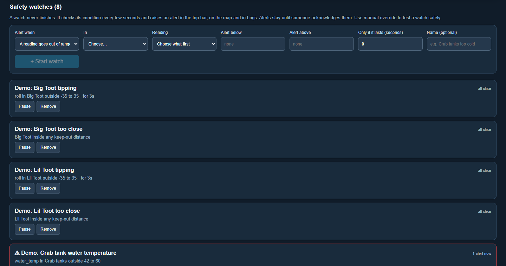
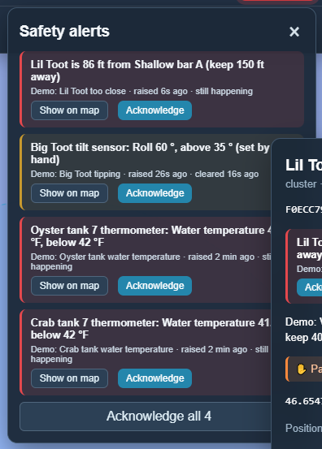
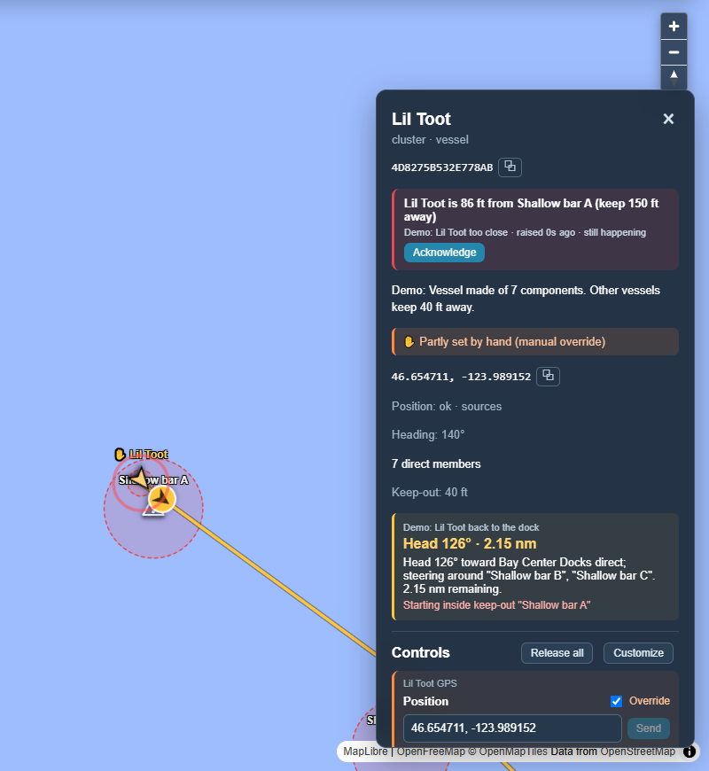

# Safety watches

[← Guide](README.md)

A safety watch is a mission that never finishes. Every 5 seconds, whether or not
anyone has the dashboard open, it checks one condition and raises an alert for
each thing that breaks it.

| Watch | Raises an alert when | Example in *The whole farm* |
|---|---|---|
| **A reading goes out of range** | a number goes below a low limit or above a high limit. Pointed at a cluster, it covers every part inside that has that reading. | Water temperature outside 42–60 °F in every crab tank; roll beyond ±35° on each vessel. |
| **Too close** | a vessel comes inside any keep-out distance: hazards, baskets, and other vessels. It ignores the vessel's own parts and wherever its mission is sending it. | Lil Toot too close to a sandbar. |
| **A sensor stops reporting** | real readings stop arriving for a number of minutes (a dead thermometer battery). An override never hides a silent sensor. | Tank thermometers silent for 3 hours. |

**Only if it lasts** makes a watch wait a few seconds before alerting, so a wave
rocking the boat for a moment is not a capsize.

## What an alert looks like

- **Top bar:** a red **⚠ alerts** button. It flashes until someone acknowledges
  the alert, stays red while the problem continues, and turns amber once it has
  cleared but still needs acknowledging.
- **Map:** a pulsing ring at the spot.
- **Panels:** the alert at the top of the panel, and the tank or vessel flagged
  in red in the panel of whatever contains it (a tank in its tank house).

**Show on map** goes to the thing the alert is about. For a hidden part such as
a tank's thermometer, it opens the tank.

An alert stays until a person presses **Acknowledge**, even after the problem
has gone away, so nothing is missed because it fixed itself.

## Testing a watch

Use [manual override](manual-override.md): drag a vessel into a keep-out, set a
roll of 60°, or set a tank's water temperature to 38 °F, and watch the alert
appear, marked *(set by hand)*. Set it back, or release the override, and the
alert turns amber until someone acknowledges it. The *Capsize test*, *Crab tank
goes cold* and *Rescue* [scenarios](scenarios.md) each set one up to
try.

Every alert, clearing and acknowledgement is written to
[Logs](logs-and-history.md) under *safety* with the readings that caused it.
Watches can be paused or removed from the **Missions** page.
