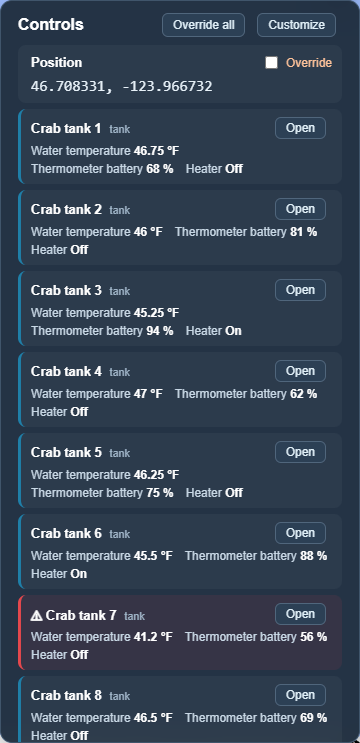
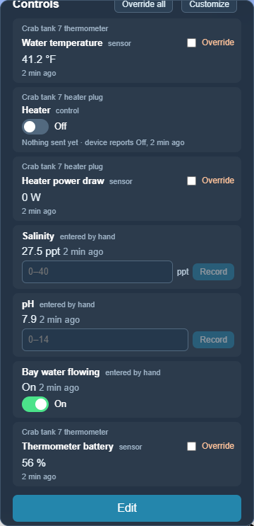
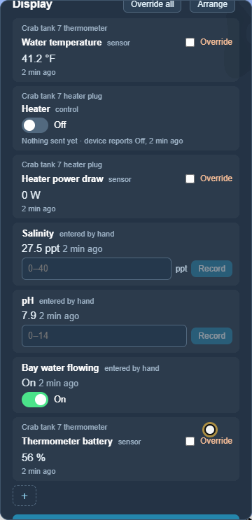
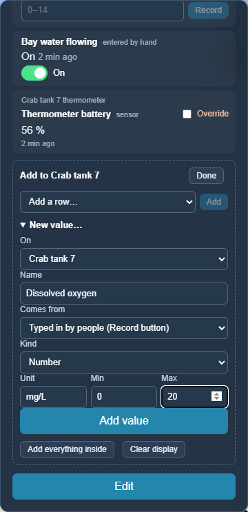

# Tanks and controls

[← Guide](README.md)

## The control column

Every node and cluster has a column of controls in its panel. Each row is one
value, and works according to where the value comes from:

| Kind | Example | What the row lets you do |
|---|---|---|
| **sensor** | water temperature, GPS heading, heater power draw | Shows the latest reading and how old it is. Tick *Override* to set it by hand for testing. |
| **entered by hand** | salinity, pH, "bay water flowing" | People measure it and type it in: enter the number and press **Record**. |
| **control** | heater plug, motor, latch | A switch, a slider with **Send**, or a one-press button. Undergrowth sends the command; the row shows both what was sent and what the device last reported. |

Typed numbers are only sent when you press **Send** / **Record** or Enter, so
`256` is never sent as `2`, `25`, `256`.

## Tank houses

*The whole farm* scenario has two tank houses: **Crab tanks** (10 tanks) and **Oyster tanks**
(8 tanks). Each tank has:

- a **floating thermometer** (Bluetooth/Zigbee pool thermometer): water
  temperature and battery;
- a **heater plug**: a remote plug relay Undergrowth can switch, plus how much
  power the heater is drawing (this shows whether a self-regulating heater is
  actually heating);
- readings **typed in by hand**: salinity, pH, and whether bay water is flowing.

Click a tank house to see all its tanks in one list. A tank with an alert is
flagged in red, and **Open** goes to that tank's own panel.

 

Switching a heater on and recording a salinity reading:

In a scenario no real plug is connected, so the row says *Sent On · device reports
Off*. With a real plug, the device's report would follow.

The *Crab tank goes cold* [scenario](built-in-scenarios.md) switches a heater off
and lets a tank go cold, to see what happens on a winter night.

## Changing what a panel shows

A motor controller, a vessel and a tank house each need different things on
screen. Press **Customize** in any panel to:

- move rows up and down (↑ ↓) or remove them (✕);
- add a row for any value of anything inside it;
- add a **new value**: give it a name, say whether people type it in, a sensor
  reports it, or Undergrowth controls it, and give a unit and range.

Changes save immediately. **Back to automatic column** undoes them.

