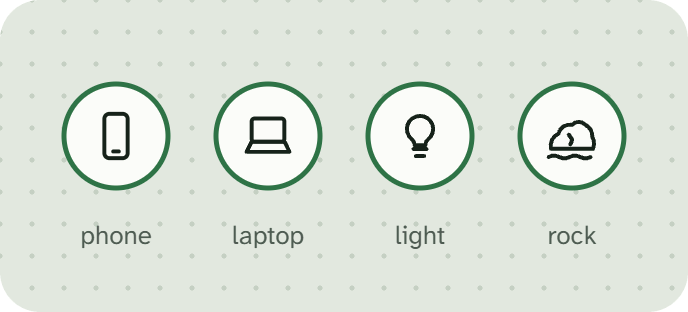
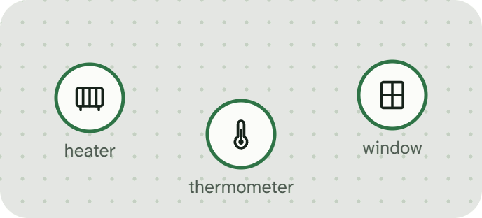
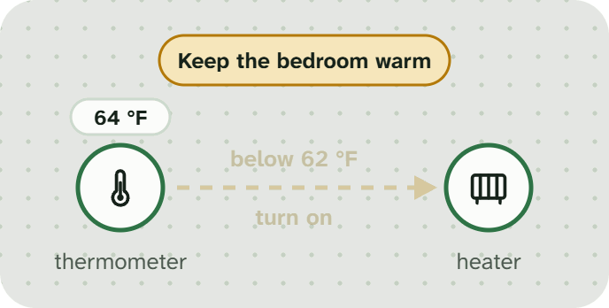
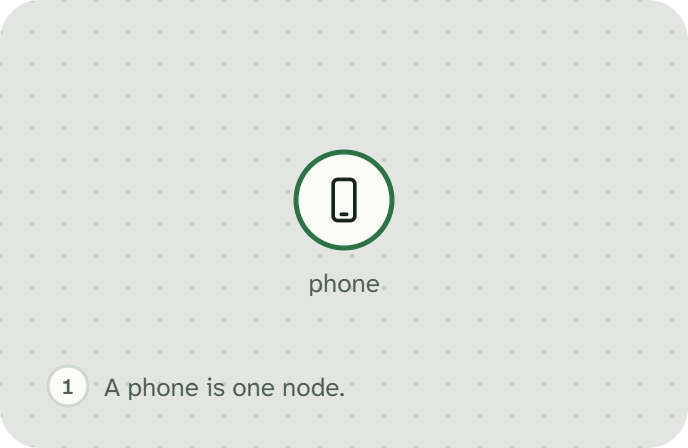
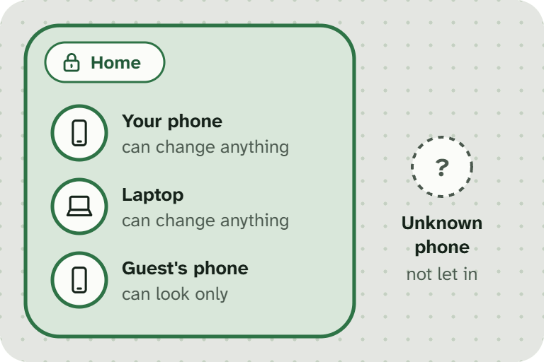
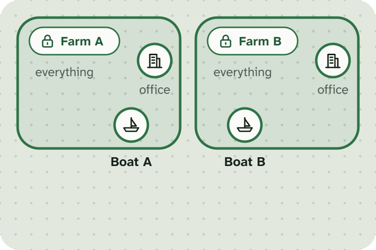
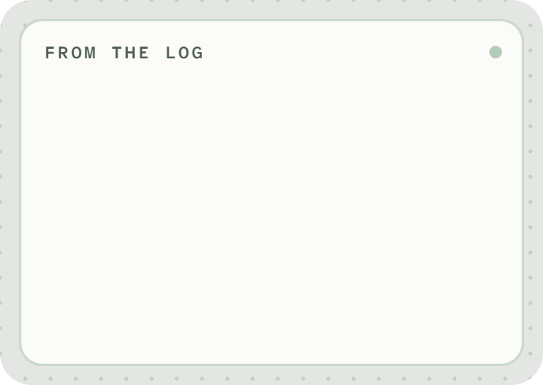

# Three ideas for looking after anything

[← Guide](README.md)

Homes, boats, gardens and labs are all made of the same three things. Learn
them once, and you can watch and control any of them. Undergrowth is built on
these three ideas.

## Node: one thing

A phone, a laptop, a light. Even a rock your boat has to avoid.

<picture>
  <source media="(prefers-reduced-motion: reduce) and (prefers-color-scheme: dark)" srcset="images/three-ideas-node-dark.png">
  <source media="(prefers-reduced-motion: reduce)" srcset="images/three-ideas-node.png">
  <source media="(prefers-color-scheme: dark)" srcset="images/three-ideas-node-dark.gif">
  
</picture>

## Cluster: things that belong together

A bedroom is its heater, thermometer and window. A boat is its GPS, motor and
radio.

<picture>
  <source media="(prefers-reduced-motion: reduce) and (prefers-color-scheme: dark)" srcset="images/three-ideas-cluster-dark.png">
  <source media="(prefers-reduced-motion: reduce)" srcset="images/three-ideas-cluster.png">
  <source media="(prefers-color-scheme: dark)" srcset="images/three-ideas-cluster-dark.gif">
  
</picture>

## Mission: a job for them, once or over and over

Over and over: when the bedroom drops below 62 °F, turn the heater on. Once:
bring the boat home.

<picture>
  <source media="(prefers-reduced-motion: reduce) and (prefers-color-scheme: dark)" srcset="images/three-ideas-mission-dark.png">
  <source media="(prefers-reduced-motion: reduce)" srcset="images/three-ideas-mission.png">
  <source media="(prefers-color-scheme: dark)" srcset="images/three-ideas-mission-dark.gif">
  
</picture>

## A node can become a cluster, and a cluster can become a node

<picture>
  <source media="(prefers-reduced-motion: reduce) and (prefers-color-scheme: dark)" srcset="images/three-ideas-grow-dark.png">
  <source media="(prefers-reduced-motion: reduce)" srcset="images/three-ideas-grow.png">
  <source media="(prefers-color-scheme: dark)" srcset="images/three-ideas-grow-dark.gif">
  
</picture>

1. A phone is one node.
2. Plug it into a battery pack. Phone, cable and battery are now a cluster.
3. Step back. On the desk, the whole charging kit counts as one thing.

**Node or cluster?** Ask what you'd replace if it broke. If a phone's camera
breaks, you replace the phone, so the phone is one node. If the cable breaks,
you replace only the cable, so the cable is a node of its own.

## Some clusters are locked

A locked cluster only trusts what has been let in, and can give each member
different rights.

<picture>
  <source media="(prefers-reduced-motion: reduce) and (prefers-color-scheme: dark)" srcset="images/three-ideas-lock-home-dark.png">
  <source media="(prefers-reduced-motion: reduce)" srcset="images/three-ideas-lock-home.png">
  <source media="(prefers-color-scheme: dark)" srcset="images/three-ideas-lock-home-dark.gif">
  
</picture>
<picture>
  <source media="(prefers-reduced-motion: reduce) and (prefers-color-scheme: dark)" srcset="images/three-ideas-lock-rescue-dark.png">
  <source media="(prefers-reduced-motion: reduce)" srcset="images/three-ideas-lock-rescue.png">
  <source media="(prefers-color-scheme: dark)" srcset="images/three-ideas-lock-rescue-dark.gif">
  
</picture>

Each member has its own rights, and a phone that hasn't been let in gets
nothing. One thing can also be in more than one locked cluster. Two rival boats
can join a rescue and share where they are, and nothing else.

*In Undergrowth, locking a cluster is called turning on **authentication**, and
it works today: see
[Let them trust each other](setup-greenhouse.md#4-let-them-trust-each-other).
For now, every member of a locked cluster can see and change everything in it.
Different rights for different members are planned.*

## Why it helps

Most gadgets come with their own app, and none of them show how everything fits
together. With nodes, clusters and missions, you decide what goes with what.
Every part, and the whole, then gets the same kind of oversight.

- **Inexpensive.** It runs on things you already own, like an old phone or a
  laptop.
- **Universal.** The same three ideas fit a house, a boat, a greenhouse or an
  oyster farm.
- **Readable by anyone.** Every reading, change and decision is written down in
  plain words, with when and why.

<picture>
  <source media="(prefers-reduced-motion: reduce) and (prefers-color-scheme: dark)" srcset="images/three-ideas-log-dark.png">
  <source media="(prefers-reduced-motion: reduce)" srcset="images/three-ideas-log.png">
  <source media="(prefers-color-scheme: dark)" srcset="images/three-ideas-log-dark.gif">
  
</picture>

For the rules behind all of this, see [Fundamental logic](fundamental-logic.md).
