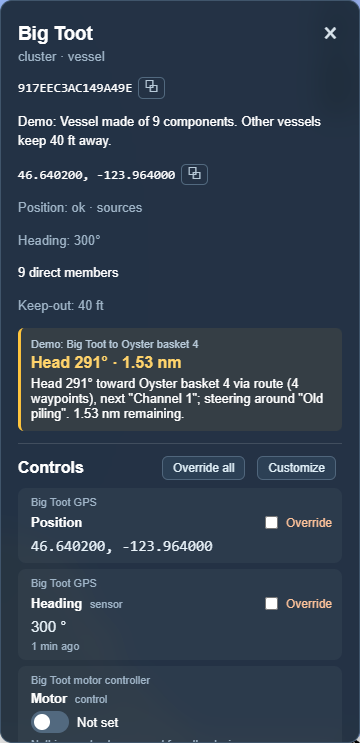
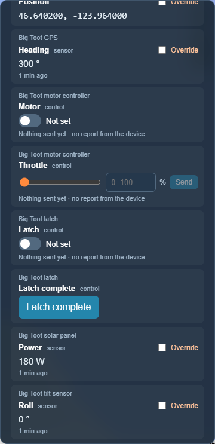
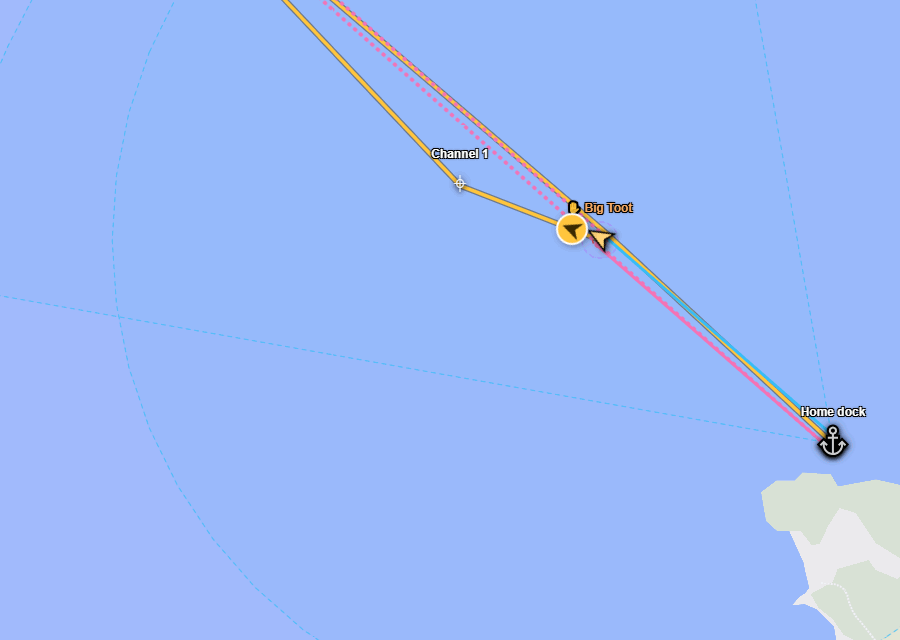
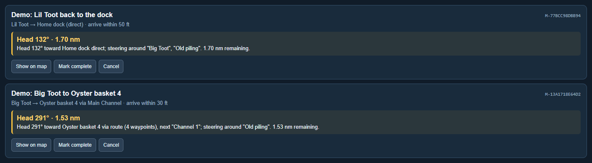

# Vessels and missions

[← Guide](README.md)

## A vessel is a cluster of parts

Click a vessel and its panel lists what it is made of. In *The whole farm*
scenario, *Big Toot*
has a GPS, a motor controller, a latch, a solar panel, a tilt sensor, a computer
and a radio. The vessel's position comes from its GPS, and every other part
follows it.

 

The panel shows:

- **Mission advice** in the gold box: which way to head, how far to go, and why
  ("Head 291° toward Oyster basket 4 via route, next Channel 1, steering around
  Old piling").
- **Controls**, one row per value, described in [Tanks and controls](tanks-and-controls.md).

## Routes and keep-outs

- A **route** is a cluster of waypoints. Their order does not matter: Undergrowth
  joins them with the shortest set of connections (the dashed blue lines).
- A **keep-out** is any node with a *keep-out distance*. Hazards, baskets and
  vessels all have one. Missions bend their path around keep-out circles.

## Navigate missions

A navigate mission says "get this vessel to that place", optionally by way of a
route, and how close counts as arrived. Create them on the **Missions** page.

Missions do not remember where a vessel was supposed to be. Every few seconds
the plan is worked out again from **where the vessel is now**, so you can pick a
vessel up, put it down anywhere, and the advice follows:

(Dragging needs the vessel's position to be under [manual override](manual-override.md).)

A route is only used when it helps. Near the route, the plan joins it and
follows it. Out in open water, far from it, the plan heads straight for the
target instead.

When the vessel is close enough, the advice changes to **Arrived — hold
position**. The mission doesn't finish by itself: press **Mark complete** on
the Missions page when the job is done.

When the decision changes (a new heading, a new next waypoint, a keep-out to
avoid, arriving), the reason and the inputs it was based on are written to
[Logs](logs-and-history.md).

The *Boat to a basket* [scenario](built-in-scenarios.md) has one boat, one
route and one keep-out to try all of this on.

## Taking a boat in tow

Sometimes two boats become one: a boat with a failed engine is towed home, or
a barge is pushed along by a skiff. Undergrowth does this with two edits:

1. **Make the towed boat part of the other.** Open the boat doing the towing,
   press **Edit**, and tick the towed boat under **Cluster Members**.
2. **Give the towed boat the other's position.** Open the towed boat, press
   **Edit**, press **＋** next to **Position**, tick the boat doing the towing,
   untick the towed boat's own GPS, and save.

Now the towed boat goes wherever the other goes. Safety watches treat it as a
part of the boat doing the towing, so being alongside doesn't set off a
too-close alarm. To cast off, undo both edits.

A boat sent on a mission to another boat is never warned about getting close
to it, so a rescue boat can come alongside without an alarm. Once the mission
is marked complete, the two are just boats again until they are joined. The
*Rescue* [scenario](built-in-scenarios.md) walks through all of this.
