# Walkthroughs

[← Guide](README.md)

Two jobs done from start to finish, with what Undergrowth decides at each step
and why. Every picture was taken doing exactly these steps in *The whole farm*
scenario, so you can follow along there without touching your real records.
For ready-made examples that are already set up, see [Scenarios](scenarios.md).

1. [A test vessel, a route, and a trip](#1-a-test-vessel-a-route-and-a-trip)
2. [A new crab tank](#2-a-new-crab-tank)

---

## 1. A test vessel, a route, and a trip

We build a small boat from nothing, lay out a route up the bay, send it to
oyster basket 2, and move it along by hand to watch the decisions change.

### Step 1: the GPS

Everything starts as a node. Right-click the water where the boat is and choose
**＋ Add Node Here**. The coordinates are filled in from where you clicked.

- **Map Name:** Test Skiff GPS · **Node Type:** gps · **Map Icon:** GPS
- Untick **Show on Map**: we will show the boat, not its parts.

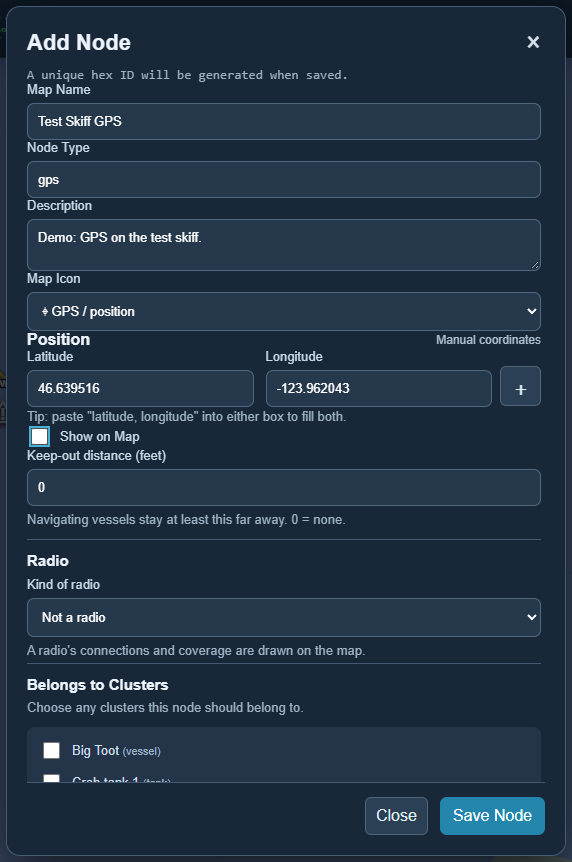

### Step 2: the vessel

A vessel is a cluster of parts. On **Clusters**, press **+ Add Cluster**:

- **Map Name:** Test Skiff · **Cluster Type:** vessel · **Map Icon:** Triangle
- **Position:** press **＋** and tick *Test Skiff GPS*. The boat is now wherever
  its GPS is.
- **Keep-out distance:** 40 ft, so other vessels give it room.
- **Cluster Members:** tick *Test Skiff GPS*. **Show on Map:** ticked.

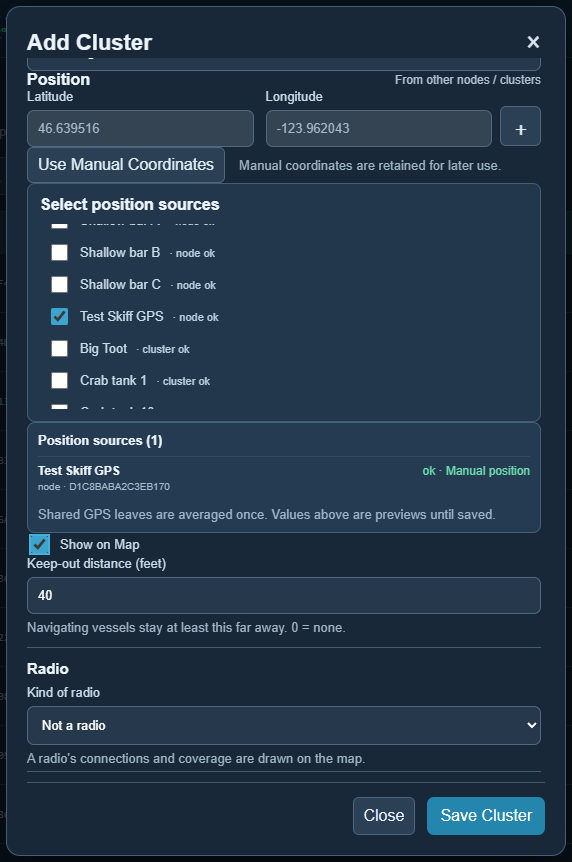

> **Decision note:** the vessel has no coordinates of its own. If the GPS is
> replaced or moved, the vessel follows without being edited.

### Step 3: waypoints

Right-click three spots up the bay and choose **⌖ Add Waypoint Here** for each:
*Test WP 1*, *Test WP 2*, *Test WP 3*.

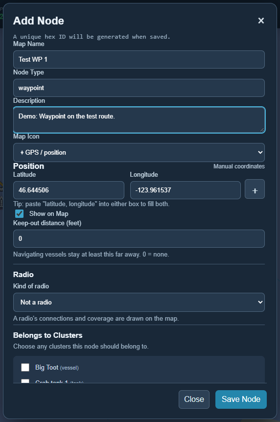

### Step 4: the route

A route is a cluster of waypoints. **+ Add Cluster** again: name *Test Route*,
type **route**, and tick the three waypoints as members.

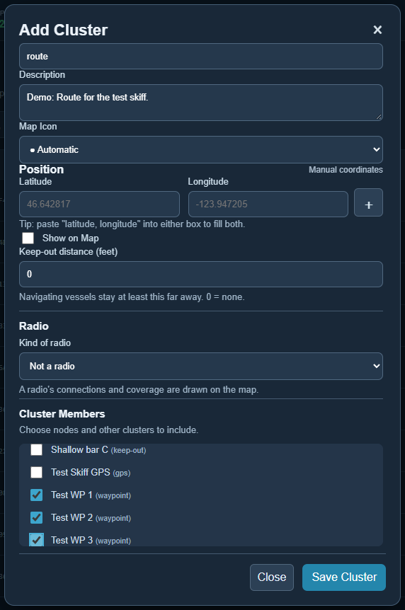

> **Decision note:** the order you tick them in does not matter. Undergrowth
> joins waypoints with the shortest set of connections, so a line of waypoints
> becomes a channel and a branching set becomes a branching channel.

### Step 5: the mission

On **Missions**, leave **When** on *Always* and **Advise a vessel the way
somewhere** ticked. Choose the vessel, where it is going and the route, and
press **+ Add mission**.

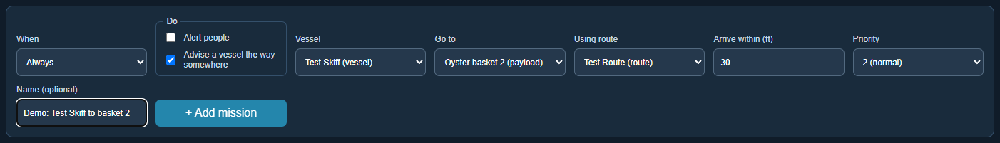

### Step 6: the trip

Click *Test Skiff*. Its [display](nodes.md#displays) is blank, because every new
display starts that way, so press **＋** and add *Test Skiff GPS · Position*.
Tick **Override** next to it (this is [manual override](manual-override.md),
standing in for a real GPS), and move the boat along. Each time it moves, the plan is worked out again from where it is
now.

**At the start.** The route is worth joining, so the advice is to head for its
nearest waypoint:

> Head 004° toward Oyster basket 2 via route (3 waypoints), next "Test WP 1". 1.42 nm remaining.

**At waypoint 1.** That waypoint counts as reached, so the advice moves on to
the next one:

> Head 338° toward Oyster basket 2 via route (2 waypoints), next "Test WP 2". 1.12 nm remaining.

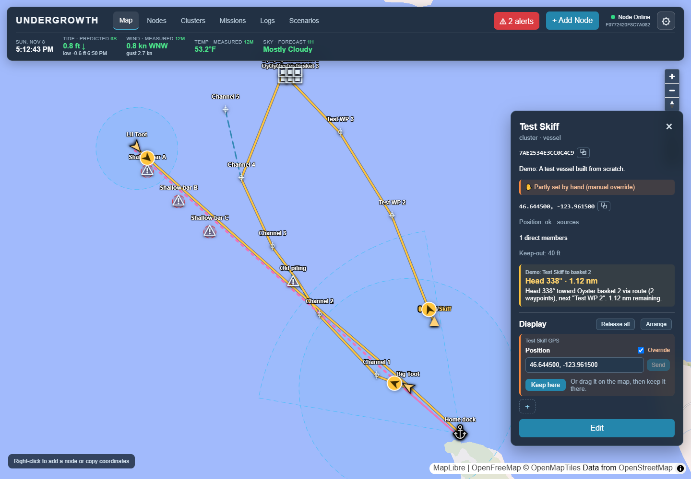

**Past waypoint 2.** From here, going straight to the basket is shorter than
detouring to waypoint 3, so the route is left behind:

> Head 320° toward Oyster basket 2 direct. 0.47 nm remaining.

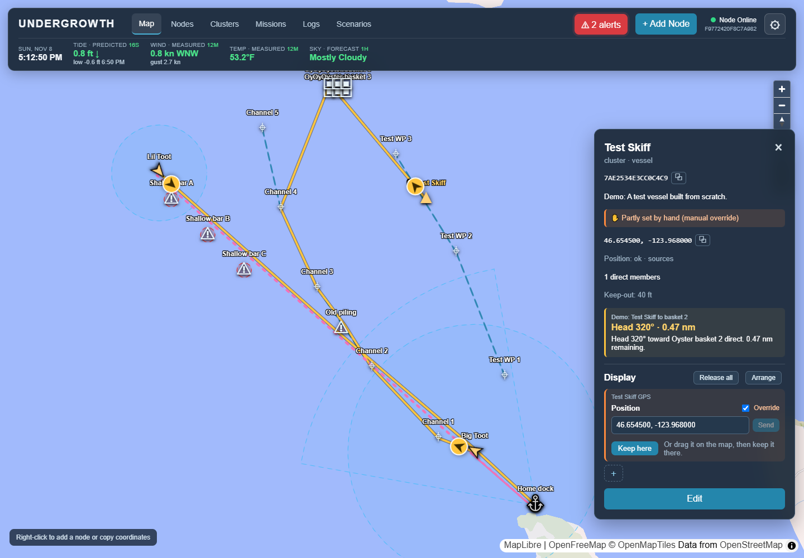

> **Decision note:** travel off the route counts as one and a half times as
> costly as travel along it. Undergrowth prefers the route, but not at any
> price: when the route would mean a long way round, it goes direct.

**At the basket.** Within the 30 ft arrival distance:

> Arrived: within 30 ft of Oyster basket 2. Hold position.

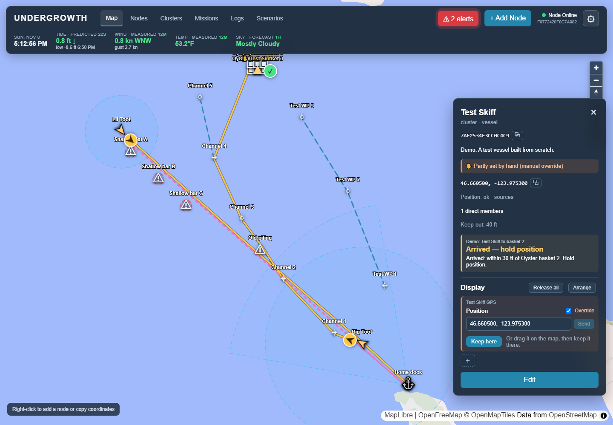

### Step 7: the record

Every time the decision changed, the reason and the positions it was based on
were written to **Logs** (category *mission*), marked as set by hand:

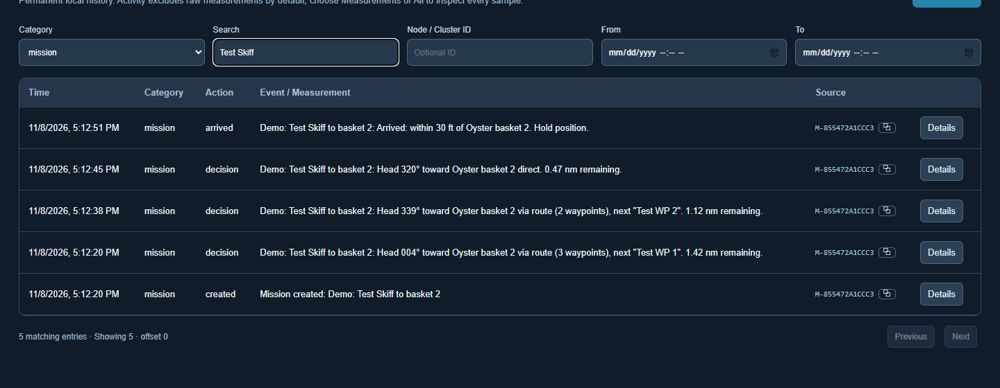

---

## 2. A new crab tank

The crab tank house in *The whole farm* has 10 tanks. We add an eleventh: the tank, its floating
thermometer and its heater plug, and put it in the tank house.

### Step 1: the tank

On **Clusters**, **+ Add Cluster**: name *Crab tank 11*, type **tank**. For its
position, press **＋** and tick *Crab tanks*: the tank is wherever its
tank house is. Untick **Show on Map**; the tank house stands for all its tanks.

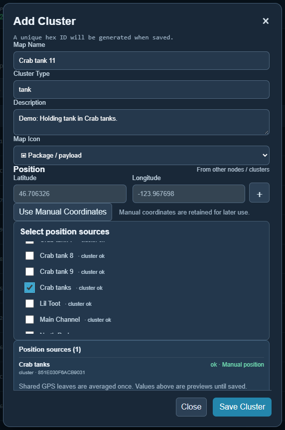

### Step 2: its parts

On **Nodes**, **+ Add Node**, twice:

- *Crab tank 11 thermometer* (type **sensor**), the floating pool thermometer;
- *Crab tank 11 heater plug* (type **relay**), the remote plug the heater is on.

For each: position from *Crab tank 11*, **Show on Map** unticked, and under
**Belongs to Clusters** tick *Crab tank 11*.

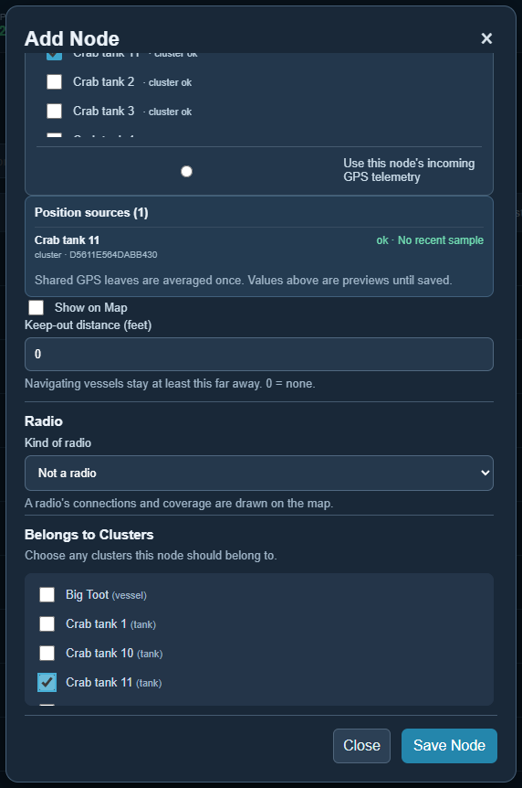

### Step 3: into the tank house

On **Clusters**, **Edit / Membership** on *Crab tanks*, and tick
*Crab tank 11* as a member.

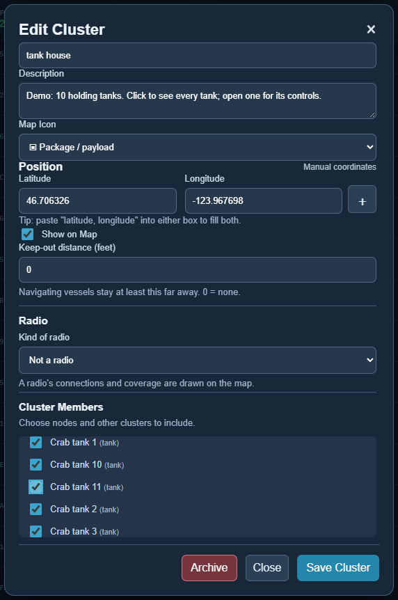

### Step 4: what each part measures or does

Still on **Clusters**, press **▸** beside *Crab tank 11*. Its display opens
underneath, and it's blank. Press **＋**, and under **New value…** add:

| On | Name | Comes from | Kind |
|---|---|---|---|
| Crab tank 11 thermometer | Water temperature | A sensor reports it | Number, °F, 28–90 |
| Crab tank 11 heater plug | Heater | Undergrowth controls it | On / off |
| Crab tank 11 | Salinity | Typed in by people | Number, ppt, 0–40 |

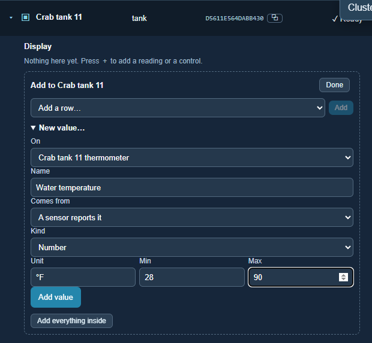

Each new value goes straight onto the display. Once the thermometer sends its
first reading, the tank's display has everything: the temperature with its
age, a switch for the heater, and a box to record salinity by hand. None of it
needed the map.

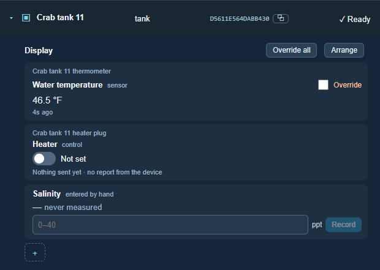

### Step 5: on the tank house's display

Press **▸** beside *Crab tanks*, then **＋**, and add *Crab tank 11 · its own
display*. The tank house now lists it alongside the others:

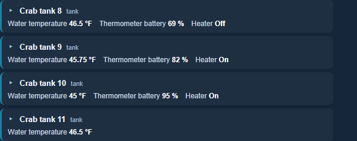

> **Decision note:** the *Crab tank water temperature*
> [mission](missions.md#alerting-people) looks at every water temperature inside the
> tank house, so the new tank was covered the moment it joined in step 3, before
> it was on any display. What a display shows is up to you; what missions look
> at follows what is inside what.
